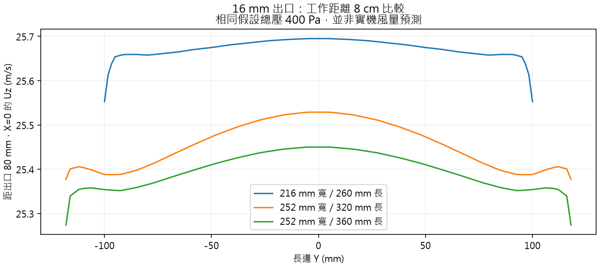

# 16 mm 出口展寬及加長：ANSYS 比較

2026-11-14。依最新要求，出口間隙維持 **16 mm**，淨長由 216 展寬為 **252 mm**，外寬約 **256.8 mm**，小於 300 mm。沿用已列印的 200 mm 單件本體，透過新的吹嘴把總長增加為 320 或 360 mm。此次交付以 **320 mm 總長**為優先試作選項；另一長度保留作對照。原本無補強肋、無定位銷的一體設計維持。

本報告的正式比較與交付吹嘴均為 16 mm 出口。

## 幾何與試作建議

推薦先使用 `print/STL/lip_252x16_H320_no_ribs_mm.stl`。STL 已在平台平面旋轉 45°、底面 Z=0，單位 mm、100% 匯入。新吹嘴列印包絡約 **194.3 × 194.3 × 126 mm**；加四周 5 mm brim 仍可放入 K1C 220×220×250 mm 成形空間。

入口接口沿用 216×20 mm，流道平滑過渡至 252×16 mm。接合止面 Z=200，定位裙向下伸 6 mm，因此吹嘴實體列印高度為總長減 194 mm。整組法蘭到出口總長，與單獨吹嘴列印高度是不同尺寸。

兩種新吹嘴都能接回同一個現有單件本體；已印好的本體無須重印。使用 4 支 M3×16 mm 螺絲及 4 顆 M3 螺母接合；原風機法蘭 12 支固定螺絲沿用。先放本體螺母，再從上方套入新吹嘴，硬止面靠合後均勻輕鎖；有密封需求時，鎖合後從接縫外側貼膠帶。

0.4 mm 噴嘴、PLA／PLA+ 可從 0.20 mm 層高、6 道壁、5 mm brim 開始切片。檢查接合耳座與定位裙的局部支撐，清除孔口與流道毛邊。名義截面壁厚維持 2.4 mm；實際剛性、翹曲與列印高低差尚未驗證。兩側出口上緣在模型中同高，詳細數值在 `cad/airpath_checks.json`。通用 3MF 只含模型及擺放位置，沒有預先切片或 G-code。

## A. 同流量比較

同樣名義 3 m³/min、出口表壓 0 Pa。網格離散的實際流量約 2.9998 m³/min。入口靜壓包含出口加速需求；不可逆總壓損另列，兩者不能混用。

| 總長 mm | 出口淨長 mm | 入口靜壓 Pa | 入口到出口總壓損 Pa | 出口面平均 Uz m/s | 內部負軸向速度體積 % |
|---|---:|---:|---:|---:|---:|
| 260 | 216 | 114.15 | 10.02 | 14.47 | 0.000419 |
| 320 | 252 | 83.93 | 12.80 | 12.40 | 0.000311 |
| 360 | 252 | 86.20 | 14.90 | 12.40 | 0.000245 |

展寬增加出口面積，在固定流量下會降低出口平均速度與加速所需壓力；更長的壁面仍會增加摩擦。較低入口靜壓不等於所有壓損下降。

## B. 相同假設總壓下的自由射流

入口總表壓固定 **400 Pa**，周圍與遠場表壓 0 Pa。這是公平比較幾何用的假設邊界，**不是風機實際工作點**。風機圖片的 11 m³/min 與 460 Pa 靜壓沒有完整 P–Q 曲線，不能同時強制當作裝上吹嘴後的實際條件，也不能把 460 Pa 靜壓直接視為 400 Pa 總壓。

| 總長 mm | 出口淨長 mm | 算得流量 m³/min | 出口面平均 Uz m/s | 8 cm 共用中央線 Uz m/s | 8 cm 各自涵蓋線 CV % | 8 cm 動量通量 N |
|---|---:|---:|---:|---:|---:|---:|
| 260 | 216 | 5.099 | 24.58 | 25.67 | 0.087 | 2.538 |
| 320 | 252 | 5.776 | 23.87 | 25.46 | 0.204 | 2.802 |
| 360 | 252 | 5.715 | 23.61 | 25.40 | 0.157 | 2.746 |

共用中央線為 X=0、Y=−100…100 mm 上 101 點平均，並非整個工作面的平均速度。各自涵蓋線長度為出口淨長減 16 mm：原版 200 mm、新版 236 mm，共 121 點，用來看更寬範圍的均勻度。動量通量在所有案例使用相同視窗 X=±40、Y=±160 mm，積分 ∫ρ max(Uz,0)²dA；它不是傘布的實測作用力。

在此假設下，所選版本相較原版：流量變化 **+13.27%**，8 cm 共用中央線速度變化 **-0.81%**，動量通量變化 **+10.39%**。360 mm 相較 320 mm 的 8 cm 動量差異為 **-1.98%**；這些差異須連同更長零件的材料、空間與列印需求一起判斷，不能只看長度。

360 mm 版的涵蓋線速度 CV 略低（0.157% 對 0.204%），但兩者在這條線上都很均勻；320 mm 版的流量與前向動量較高，零件也較短，因此優先試作 320 mm。

## 求解設定及驗證

Fluent Student 2026 R1，3D 雙精度、4 CPU，穩態不可壓縮、SST k–ω，ρ=1.2 kg/m³、μ=1.8×10⁻⁵ Pa·s；光滑無滑移壁面，入口紊流強度 5%、水力尺度 84 mm。冷啟動先 80 步一階，之後動量與紊流二階迎風、壓力二階。自由射流使用前案計算場作初始猜測後，再由 Fluent 重新迭代；初猜不等同求解結果。

基準自由射流網格 425240 cells／448600 nodes；320 mm 標準案例 444680 cells／469690 nodes。額外驗證 320 mm 案例，加密截面並將外部長度由 250 增至 400 mm，網格為 826880 cells／864879 nodes。各案都低於 Student 百萬 cells 與 nodes 限制，細胞體積均為正。

| 指標 | 標準網格／250 mm 域 | 加密／400 mm 域 | 差異 |
|---|---:|---:|---:|
| flow_m3_min | 5.7761 | 5.7603 | -0.273% |
| slot_mean_Uz_m_s | 23.866 | 23.807 | -0.245% |
| 80mm_common_line_Uz_m_s | 25.465 | 25.493 | +0.113% |
| 80mm_momentum_N | 2.8018 | 2.7953 | -0.234% |

此為網格與外部域長同時改動的敏感度檢查，並非正式 GCI，也沒有把兩種影響分離。360 mm 案例未另做加密研究。

工程收斂門檻：連續性 <10⁻⁴、速度 <10⁻⁶、k／ω <10⁻⁵，最後兩批入口靜壓與流量變化各 <0.5%，質量不平衡 <0.1%。全案通過此門檻；另列是否全部殘差都達 10⁻⁵。

| 案例 | 最後迭代 | 連續性殘差 | 質量不平衡 % | 全殘差 <10⁻⁵ |
|---|---:|---:|---:|---|
| body_H260_W216 | 176 | 8.69e-06 | 8.346e-07 | 是 |
| jet_H260_W216 | 222 | 9.8e-06 | 0.0001158 | 是 |
| body_H320_W252 | 179 | 8.85e-06 | 2.644e-07 | 是 |
| jet_H320_W252 | 215 | 9.74e-06 | 0.0002786 | 是 |
| body_H360_W252 | 179 | 9.11e-06 | 4.603e-07 | 是 |
| jet_H360_W252 | 240 | 1.73e-05 | 0.0007294 | 否 |
| jet_H320_W252_fine | 240 | 1.15e-05 | 0.0001022 | 否 |

原生 case/data 重新讀取後，入口靜／總壓及各邊界質量流率與儲存紀錄核對，結果在 `cfd/reopen_checks.json`。原生 case/data、網格及場資料保留在本機 `cfd`，列印 ZIP 僅收錄摘要、表格、曲線、圖片及檢查紀錄。

## 回流與實測限制

內部負軸向速度統計只包含 z<出口高度且 Uz<−0.01 m/s 的體積。外部環境吸入屬射流捲吸，不能把原始全域負速度比例或遠場邊界回流當作鼓風機吸入口倒吹。原始 `outlet` 欄位是遠端計算盒邊界，實體出口與工作距離數據請使用 `free_jet_metrics`。

模型不包含風機葉輪、蝸殼、實際入口旋流與非均勻分布，也不包含傘布、水膜、熱傳、接縫滲漏、列印粗糙度、外耳附近環境流與瞬態失速。自由射流保留出口壁厚，外接合耳座不作外流解析。無法藉此證明風機吸入口回流完全排除，也不能證明整把傘吹 10 秒後不滴水。

實印後建議用同一把傘、相同浸濕與預滴水時間、固定供電和轉傘方式，在 3／5／8 cm 各測 3 次；吹 10 秒後，觀察停止吹風後 5 秒的滴數，並記錄吸入口方向與脈動。起始帶水量盡量一致。原始模型檔案保持不變，詳見 `source_integrity.json`。
