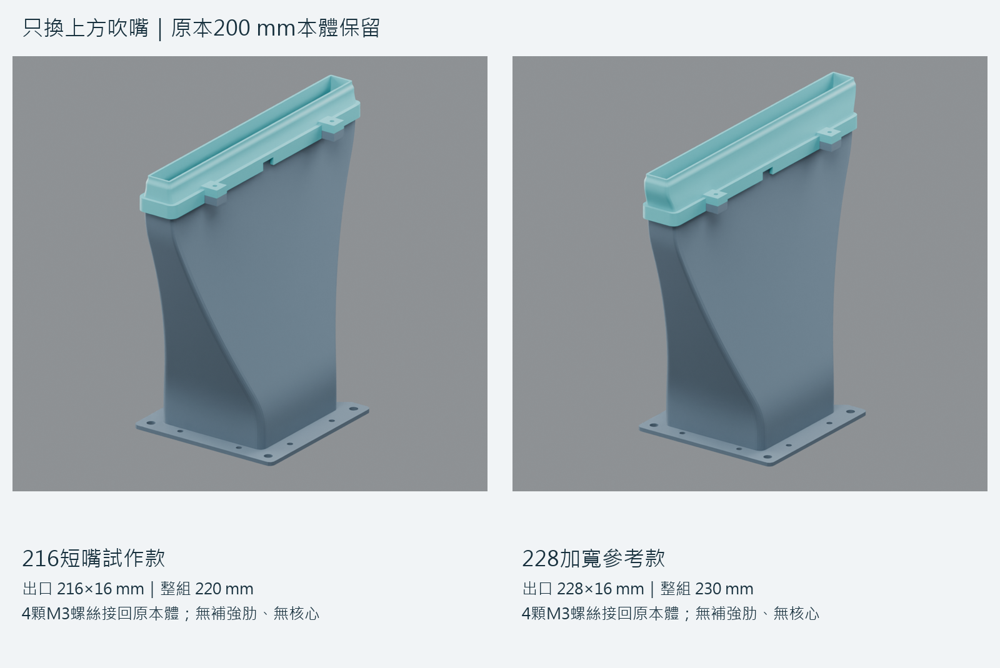
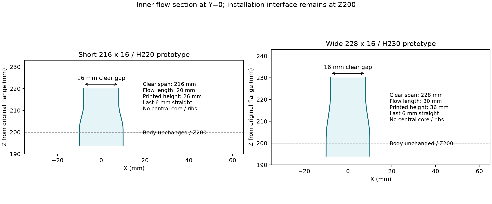
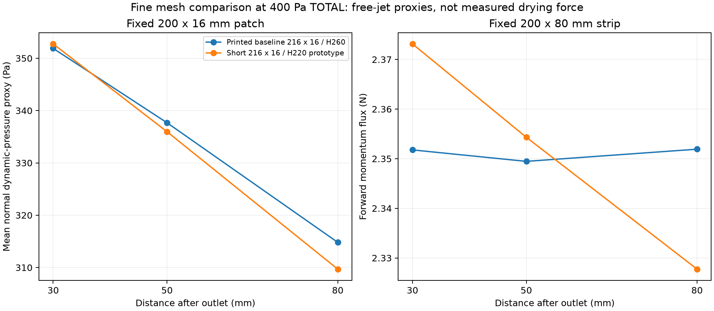
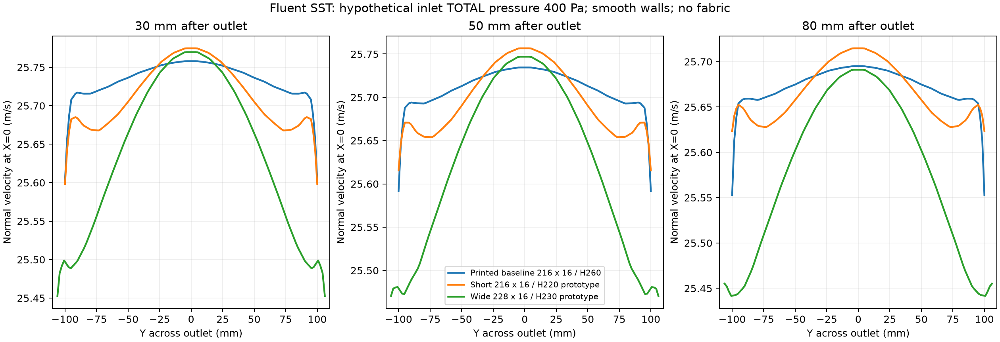
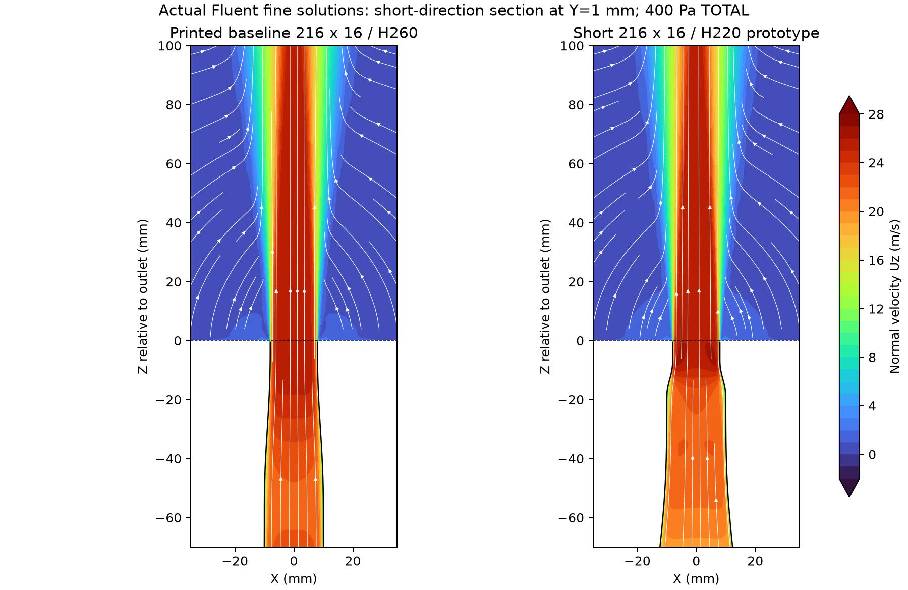

# 保留現有本體：16 mm吹嘴改良與ANSYS比較

2026-11-14。實際基準為你已列印的 **216×16 mm、整組260 mm、無補強肋版**。本次只重印上方吹嘴，保留原200 mm本體、原鼓風機法蘭12孔，以及4個M3接合點。原始版本的檔案雜湊全數未變。

## 使用選擇

**目前不建議只為了『更強』重印。** 在同一假設400 Pa入口總壓、相同吹拂面積下，216短嘴加密後於3、5、8 cm的動壓指標相對原版為 **+0.24%、-0.51%、-1.63%**。此結果不足以支持明顯吹力升級。先沿用現有件，核對實體出口是否等寬16 mm、接縫是否漏氣，以及出口至傘布的距離。

228加寬款的標準網格8 cm同面積動壓為 **-6.86%**，僅增加覆蓋寬度，不列為吹力升級推薦，也未進行加密驗證。兩款STL均保留，供幾何核對或自願試作；原版檔案完全未覆寫。短嘴整組220 mm、加寬款230 mm，分別比目前少40及30 mm；安裝時必須調整位置，保持相同出口至傘布距離。若出口位置固定、必須維持總長260 mm，請繼續使用原嘴；另兩個維持260 mm的篩選方案也未顯示明顯增益。

| 版本 | 出口淨尺寸mm | 整組總高mm | 吹嘴實體高mm | STL已轉45°的列印尺寸mm |
|---|---:|---:|---:|---:|
| 216短嘴試作款 | 216×16 | 220 | 26 | 178.2×178.2×26 |
| 228加寬參考款 | 228×16 | 230 | 36 | 178.5×178.5×36 |

兩款都沒有中央核心、外部長補強肋及定位銷。空氣維持直通，出口方向與原16 mm無肋版一致。主壁厚3 mm，最後6 mm以外側斜面漸薄至1.6 mm，末端1 mm保持1.6 mm；內側出口最後6 mm為16 mm直段。壁厚與較短零件是幾何設計選擇，尚未驗證實際抗翹曲、剛性或列印結果。

## 公平比較：同一範圍、同一假設壓力

比較的是原版的理想CAD與新版CAD，尚未量測你手上實體件的翹曲、密封或真實出口尺寸。自由射流算例固定入口**總表壓400 Pa**，外界靜表壓0 Pa；此條件用來比較幾何，不代表鼓風機的實際工作點。你提供的11 m³/min與460 Pa靜壓不能直接同時當成此吹嘴的工作流量及入口總壓；缺少完整風機P–Q曲線、入口旋流和實測壓力。

以下全部為加密網格互相比較。距出口8 cm，固定中央 **200×16 mm**面積平均`0.5ρ max(Uz,0)²`；另外在固定 **200×80 mm**範圍積分`ρ max(Uz,0)² dA`。這兩者是自由射流的動壓及動量通量指標，並非傘面實際壓力、剪力、吹水量或乾燥時間。中心線速度取X=0、Y=±100 mm。

| 版本 | 預測流量m³/min | 出口平均Uz m/s | 同面積動壓指標Pa | 同範圍動量通量N | 中心線平均Uz m/s |
|---|---:|---:|---:|---:|---:|
| 原版216×16/H260 | 5.094 | 24.57 | 314.81 | 2.3519 | 25.68 |
| 216短嘴試作款 | 5.142 | 24.79 | 309.69 | 2.3277 | 25.67 |

| 版本 | 出口距離cm | 同面積動壓相對原版 | 同範圍動量相對原版 |
|---|---:|---:|---:|
| 216短嘴試作款 | 3 | +0.24% | +0.91% |
| 216短嘴試作款 | 5 | -0.51% | +0.21% |
| 216短嘴試作款 | 8 | -1.63% | -1.03% |

228 mm加寬款只完成標準網格篩選，與原版標準網格互相比較如下，不與加密結果混用：

| 版本 | 流量m³/min | 8cm同面積動壓Pa | 同面積動壓相對原版 | 同範圍動量N |
|---|---:|---:|---:|---:|
| 原版216×16/H260 | 5.099 | 311.72 | +0.00% | 2.3491 |
| 216短嘴試作款 | 5.140 | 308.17 | -1.14% | 2.3217 |
| 228加寬參考款 | 5.391 | 290.35 | -6.86% | 2.1305 |

**降低內部壓損的百分比，不能當作吹力增加的百分比。** 原版在此假設壓力下已經有較高中心線速度，因此只換上段、維持16 mm縫寬時，改善空間有限。不能據此承諾實際吹力明顯變強或10秒吹乾。

## 固定流量壓損與回流

另以3 m³/min入口體積流量、出口靜表壓0 Pa做內部流道比較。入口至出口總壓差如下。

| 版本 | 總壓損Pa | 相對原版 |
|---|---:|---:|
| 原版216×16/H260 | 10.021 | — |
| 216短嘴試作款 | 7.608 | -24.08% |
| 228加寬參考款 | 8.255 | -17.62% |

內部反向流動採`Z<出口高度`且`Uz<−0.01 m/s`的單元體積，詳見`CFD_comparison.csv`。外界邊界的逆流代表射流吸入環境空氣，不能直接視為鼓風機吸入口回流。模型未包含葉輪與蝸殼，不能確認實機風機失速或吸入口回流已消除。

篩選也計算較大幅度加寬版本。快速加寬在固定流量下出現較大的局部反向流動，因此未僅依總流量較大就判定較強。所有已完成篩選數據保存在CSV及原生case/data。

## 數值驗證與適用範圍

使用本機Fluent Student 2026 R1、3D雙精度、4 CPU、定常不可壓縮空氣、SST k–ω；ρ=1.2 kg/m³、μ=1.8×10⁻⁵ Pa·s；入口湍流強度5%、水力直徑84 mm、光滑無滑移壁面。暖啟動只提供初始猜測，之後均經Fluent實際迭代。壓力、動量及湍流最後使用二階離散。

原版與216 mm短嘴做了加密截面、上段1 mm軸向網格及下游區域250→400 mm的共同檢查。228 mm加寬款的標準網格同範圍吹拂指標已較低，僅保留標準網格篩選結果，未做加密驗證。截面與區域同時改變，屬聯合敏感度檢查，未做三層GCI，也不是誤差信賴區間。每個網格均為正體積，cells及nodes各少於Student的一百萬限制。

| 版本 | 加密後流量變化 | 8cm同面積動壓變化 | 8cm同範圍動量變化 |
|---|---:|---:|---:|
| 原版216×16/H260 | -0.10% | +0.99% | +0.12% |
| 216短嘴試作款 | +0.03% | +0.49% | +0.26% |

當增益與上述網格／計算區域變化相近時，應把差異視為不確定，不能宣稱已證實優於原版。穩態RANS的結果也未涵蓋非定常噴流、列印層紋、漏氣、軟傘面阻擋、液膜或液滴、熱傳及實際風機曲線。CFD外部模型保留出口端壁厚，外壁形狀、圓角、螺絲耳及插套沒有完整納入外部流場。

工程收斂標準：連續性殘差<10⁻⁴、速度<10⁻⁶、k和ω<10⁻⁵，最後兩批流量及入口壓力變化<0.5%，質量不平衡<0.1%。另列是否全部殘差皆<10⁻⁵，不混為同一標準。

| 案例 | 最後迭代 | 連續性殘差 | 質量不平衡% | 全殘差<10⁻⁵ |
|---|---:|---:|---:|---|
| jet_late216_p400 | 257 | 9.4e-06 | 0.000118 | 是 |
| jet_late222_p400 | 238 | 9.6e-06 | 0.000169 | 是 |
| jet_ref216_fine_p400 | 200 | 1.1e-05 | 0.000103 | 否 |
| jet_short216_fine_p400 | 200 | 1.6e-05 | 0.000153 | 否 |
| jet_short216_p400 | 280 | 1.1e-05 | 0.000198 | 否 |
| jet_wide228_p400 | 202 | 9.5e-06 | 5.61e-06 | 是 |
| screen_late216 | 67 | 6.6e-06 | 1.97e-05 | 是 |
| screen_late222 | 66 | 6.4e-06 | 1.38e-05 | 是 |
| screen_late228 | 67 | 6.5e-06 | 7.82e-06 | 是 |
| screen_short216 | 103 | 7.5e-06 | 9.72e-06 | 是 |
| screen_wide228 | 101 | 7.4e-06 | 1.43e-05 | 是 |
| screen_wide240 | 102 | 8.1e-06 | 1.16e-05 | 是 |
| screen_wide252 | 111 | 7e-06 | 1.69e-06 | 是 |

原生case/data重新開啟後核對入口壓力及邊界質量流量，紀錄在`cfd/followup_reopen_checks.json`。完整網格、流場NPZ與case/data存於本資料夾`cfd`；列印ZIP只收輕量結果及檢查紀錄。

## 列印及組裝

只需印所選吹嘴的`print/STL/head_<版本>_16mm_body200_mm.stl`，單位mm、100%匯入，已在XY平面轉45°並置底。原本體不需重印。標準3MF只含模型與擺放，未含經驗證的K1C切片設定或G-code。

K1C的220×220×250 mm範圍已核對，各零件及5 mm brim均可放入。0.4 mm噴嘴、PLA/PLA+可先以0.20 mm層高、5 mm brim試切，1.6 mm出口端壁請確認至少形成4條連續實體線；薄壁區需依實際線寬與切片預覽核對。實際切片、列印、支撐需求、接縫密封及強度尚未驗證。

接口採0.25 mm名義徑向間隙，插套向下6 mm。沿用4顆M3×16螺絲和4顆M3螺帽；先放回原本體螺帽，再把吹嘴由上方插入，四顆交替鎖緊。模型已檢查插入路徑、8 mm起子空間、裝配交集、61點16 mm縫寬、出口淨長、原法蘭12孔及中央無阻擋；檢查的是CAD，不代表實體公差已合格。

## 實測紀錄

先用相同電壓、風機檔位和進風管路，在出口距傘面3、5、8 cm各測3次；每次用同一塊傘布、相同初始含水量和方向。吹10秒，量測前後重量，記錄停風後5秒滴數、吸入口方向、是否脈動及整段吹拂均勻度。若換短嘴，需重新調整整組位置以維持相同出口距離。模板為`physical_test_template.csv`。

## 方法參考

平滑收縮輪廓以五次曲線令端點斜率平順作為設計起點，並以本幾何CFD篩選；NASA風洞收縮研究不直接證明此吹嘴有效。[Bell與Mehta，NASA 1988](https://ntrs.nasa.gov/citations/19880012661)。

壓力入口採總壓、壓力出口採靜壓的設定依[Fluent邊界條件說明](https://ansyshelp.ansys.com/public/Views/Secured/corp/v252/en/flu_ug/flu_ug_bcs_sec_bound_cond.html)；實際風機工作點仍需[壓力–流量曲線](https://ansyshelp.ansys.com/public/Views/Secured/corp/v242/en/discovery/UDA/user_manual/physics/fluids/topics/c_fluids_fans_specifyingcurve.html)。
