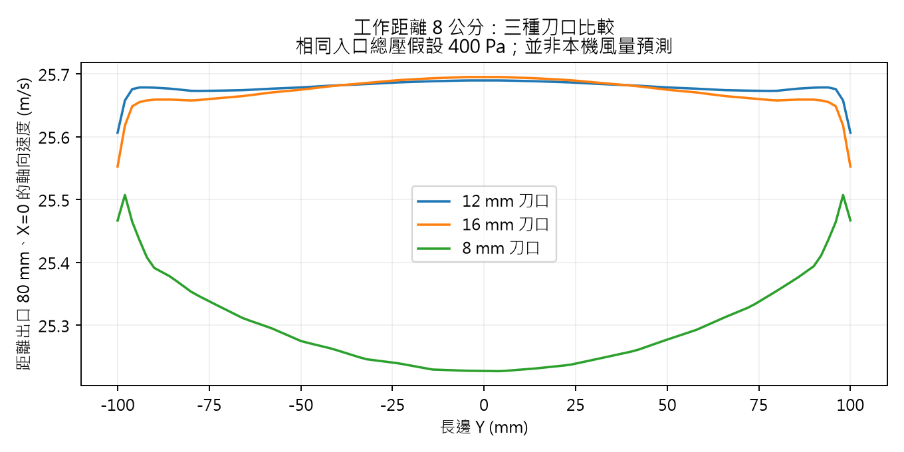

# 風刀分件試作版：CFD 比較與驗證

日期：2026-11-06。這是空氣單相工程比較；建議先試 16 mm，12 mm 作實機對照。尚無濕傘試驗，也沒有宣稱 10 秒乾燥已達成。

## 選型結論與適用範圍

在本次已比較的幾何中，選 260 mm 高、216 mm 淨長、可換吹唇。本體無核心、無內部導流片，外肋補強。選 260 mm 是為了讓各主件能以 K1C 分件列印，並兼顧流道內局部逆流與長度。此結果不是對所有幾何的全域最佳化證明。

原風機圖片提供 150FLJ330W、330 W、2800 rpm、11 m³/min、460 Pa 靜壓。完整 P–Q 曲線與各標示對應的測試工況未知。**11 m³/min 不能作為裝上任何吹嘴後都不變的實際流量；460 Pa 靜壓不能直接視為本次 400 Pa 總壓邊界。**

## 求解設定

ANSYS Fluent Student 2026 R1，3D、雙精度、4 CPU，穩態不可壓縮空氣、SST k–ω，ρ=1.2 kg/m³、μ=1.8×10⁻⁵ Pa·s。光滑無滑移壁面，無重力驅動、熱傳或水相；前 80 步一階，之後動量與紊流採二階迎風、壓力二階。敏感度案例以基準速度／壓力／紊流場插值作初猜，再以 Fluent 重新迭代。

入口紊流強度 5%、水力尺度 84 mm；這一輪新舊受控比較都採同設定。入口未建風機葉輪、蝸殼、旋流或實際非均勻速度分布。列印表面粗糙、接縫滲漏與裝配變形未建入。外補強肋遠離內部通道，CFD 保留 2.4 mm 出口端面，但沒有解析外肋附近的環境流動，屬自由射流近似。

## A. 同流量、12 mm 出口的流道比較

均設定名義入口 3 m³/min、出口表壓 0 Pa；新模型離散入口面積造成實際值約 2.9998 m³/min，差約 0.007%。這組用於比較壓損，不代表風機實際運轉流量。

| 案例 | 入口靜壓 Pa | 入口至出口總壓損 Pa | 沿長邊的間隙平均速度 CV % | 內部負軸向速度體積 % |
|---|---:|---:|---:|---:|
| legacy_Q3 | 234.67 | 27.48 | 2.07 | 0.000922 |
| H200 | 218.74 | 12.48 | 2.78 | 0.006371 |
| H260 | 219.26 | 12.92 | 2.89 | 0.000399 |
| H320 | 220.25 | 13.80 | 2.94 | 0.000037 |

`legacy_Q3` 是原 200 mm、12 mm 無核心但仍保留薄十字支撐片的版本；H200 / H260 / H320 為新的無核心無內部片系列，最後 60 mm 為吹唇。這是整套幾何改動的比較，不能把結果單獨歸因於加長或移除支撐片。

H200 損失比 H260 低約 0.45 Pa，但負軸向速度體積比例約為 H260 的 16 倍；比例皆很小，只是本次的輔助指標，並非瞬態失速判準。H320 的改善有限、零件更長。因此選 H260。新 H260 的損失相對原型降低 52.96%；入口靜壓僅降低約 6.57%，不能宣稱風速提高同樣百分比。長向均勻度未比原版更佳；表中已列出完整取捨。

## B. 自由射流：不同吹唇在假設相同總壓下比較

入口總表壓固定 400 Pa，周圍與遠場表壓 0 Pa、允許吸入環境空氣。外部計算區 X=±100 mm、Y=±200 mm，出口外延 250 mm。每個吹唇的實際通流量由求解得到；沒有加入假造風機曲線。

| 出口間隙 mm | 算得流量 m³/min | 出口面平均 Uz m/s | 3 cm 中央線 Uz | 5 cm 中央線 Uz | 8 cm 中央線 Uz | 8 cm 前向動量通量 N |
|---|---:|---:|---:|---:|---:|---:|
| 8 | 2.570 | 24.80 | 25.77 | 25.75 | 25.30 | 1.300 |
| 12 | 3.852 | 24.77 | 25.75 | 25.73 | 25.68 | 1.934 |
| 16 | 5.099 | 24.58 | 25.73 | 25.71 | 25.67 | 2.538 |

中央線指 X=0、Y=−100…100 mm 上 101 點的平均軸向速度，接近射流核心，**不是整個工作平面的平均速度**。動量通量為距出口指定平面、X=±40、Y=±130 mm 視窗內的 ∫ρ max(Uz,0)²dA，單位 N；它不是對傘布的實測作用力。

同一總壓下，8 mm 減少流量，沒有顯著提高 3–8 cm 的核心速度；16 mm 在 8 cm 的中央線速度與 12 mm 幾乎相同，前向動量通量多 31.2%。這支持優先實測 16 mm，但真實風機在較大流量處可能提供較低壓力，所以本結果不能證明裝上現有風機後 16 mm 必然優於 12 mm。需要實際風機曲線或直接實測確認。

## C. 網格、域大小與收斂

六面體貼體網格，細胞體積均為正，每案節點與細胞皆低於 Student 100 萬限制。內部 H200 / H260 / H320 分別為 146304 / 188928 / 232704 cells；標準自由射流 425240 cells、448600 nodes。12 mm 驗證案改成 797840 cells、833829 nodes，並把外部長度由 250 增至 400 mm。

| 指標 | 標準網格／250 mm 域 | 加密網格／400 mm 域 | 差異 |
|---|---:|---:|---:|
| flow_m3_min | 3.8521 | 3.8471 | -0.129% |
| slot_mean_uz_m_s | 24.767 | 24.743 | -0.095% |
| at_80mm_center_line_uz_m_s | 25.679 | 25.695 | +0.064% |
| at_80mm_momentum_N | 1.9343 | 1.9344 | +0.004% |

此為一次**網格與域長同時改動的敏感度檢查**，所有列出差異小於 5%；不是正式 GCI，也沒有把網格效應與域長效應分開。只對 12 mm 做了這項額外檢查；8 與 16 mm 沒有各自完成獨立網格研究。

工程收斂門檻：連續性 <10⁻⁴，三方向速度 <10⁻⁶，k / ω <10⁻⁵，最後兩批入口靜壓與流量變化各 <0.5%，質量不平衡 <0.1%。另列出是否全部殘差都小於 10⁻⁵，避免把工程收斂與嚴格殘差標準混為一談。

| 案例 | 最後迭代 | 連續性殘差 | 質量不平衡 % | 工程門檻 | 全部殘差 <10⁻⁵ |
|---|---:|---:|---:|---|---|
| legacy_Q3 | 197 | 9.72e-06 | 1.0008e-08 | 通過 | 是 |
| H200 | 200 | 3.08e-05 | 4.7552e-08 | 通過 | 否 |
| H260 | 174 | 9.69e-06 | 1.7903e-07 | 通過 | 是 |
| H320 | 167 | 9.59e-06 | 7.8596e-07 | 通過 | 是 |
| jet_g8 | 280 | 2.47e-05 | 0.00036747 | 通過 | 否 |
| jet_g12 | 280 | 3.24e-05 | 0.00030137 | 通過 | 否 |
| jet_g16 | 280 | 4.7e-05 | 0.00024881 | 通過 | 否 |
| jet_check12 | 140 | 9.75e-06 | 0.00017554 | 通過 | 是 |

`cfd/reopen_checks.json` 是另開 Fluent 後重讀原生 case/data 的檢查；H260、三款吹唇與加密案例重新計算入口靜／總壓及各邊界質量流率，與儲存紀錄比較。`convergence.json`、`history.json`、殘差 CSV 和原生 case/data 均保存於各案資料夾。

## 如何解讀回流與原始欄位

內部負 Uz 以各案例出口上游 z<H 且 Uz<−0.01 m/s 的 cell 體積計算；自由射流案例 H=260 mm。新系列仍有很小的局部負軸向速度，不能寫成完全零回流。自由射流周圍的環境入口發生吸入是射流捲吸；遠邊界局部流回也包含環境循環，不能稱為鼓風機吸入口倒吹。

外部案例原始 `results.json` 中的 `outlet` 是計算盒最遠端邊界，不是實體長縫。請使用 `free_jet_metrics` 的出口及工作距離數據；原始 `pressure_loss_to_domain_outlet_Pa` 包含環境捲吸與混合，不可當成吹嘴自身壓損。原始全域負 Uz 體積也包含外部空氣，與內部負 Uz 指標不同。

## 尚待實測的部分

本次沒有包含實際傘布、含水量、濕潤性、遮擋、轉傘路徑、蒸發熱傳、瞬態風機失速或進氣口流場，因此不能證明整把傘 10 秒後不滴水，也不能保證已排除實機吸入口倒吹。以 README 的 3 / 5 / 8 cm、12 / 16 mm、各 3 次測試矩陣驗證；記錄吸入口方向、脈動與吹後滴水。

幾何與製造檢查另見 `cad/geometry_checks.json`、`assembled_airpath_checks.json`、`assembly_interference_checks.json`；只有網格、尺寸、干涉與模型檔案通過檢查，不等同完成實印。
