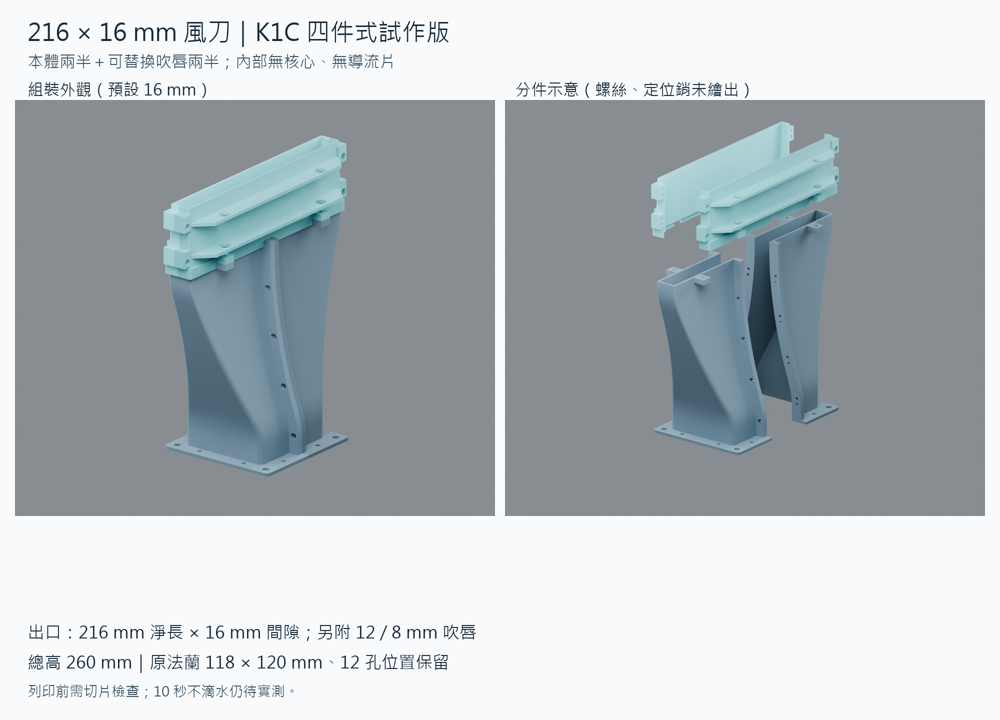

# K1C 分件風刀試作版

交付日期：2026-11-06。資料夾的 20261105 是開始工作的日期。

先試 **216 × 16 mm 出口**，保留 **216 × 12 mm** 作對照；兩者共用本體。總高 **260 mm**，本體兩半＋吹唇兩半，共四個主要列印件，另加定位銷與螺絲。內部沒有中央核心，也沒有十字導流片；補強放在外側。這是現有 150FLJ330W 鼓風機的獨立測試原型。

原始模型與原資料夾沒有覆寫；原版 16 個已記錄檔案重新核對雜湊均一致。新件保留原法蘭的 12 個孔位、孔徑與偏心位置。出口長邊沿原模型 Y，氣流沿 +Z，沒有 90 度流道轉彎。

**已完成：幾何檢查、Fluent 空氣流場比較、網格及外部域敏感度檢查。未完成：實際切片、實印、風機實測與濕傘測試。「3–8 cm、吹 10 秒後不滴水」仍是驗收目標。**

## 先列印哪些檔案

`print/plates` 是已擺放方向的通用 **模型 3MF**，沒有綁定材料、機器或 G-code。使用 K1C / 0.4 mm / PLA 或 PLA+ 設定匯入後再切片；保留方向與 100% 比例。一次只開一個盤檔，清空上一盤的模型。

1. `00_fit_test_and_16_pins.3mf`：先印配合測試塊與 16 根 2.8 × 6 mm 定位銷；每組用 12 根，餘 4 根備用。名義定位孔為 3.2 mm。
2. `01_body_A.3mf`、`02_body_B.3mf`：本體各印一盤。
3. `03_lip_16mm_pair.3mf`：先印 16 mm 吹唇一對。
4. `03_lip_12mm_pair.3mf`：需要比較時再印 12 mm 吹唇，沿用同一個本體。

`print/STL` 也有各件 STL，單位 mm，已轉成建議列印方向；`print/3MF` 是每件單獨的通用 3MF。8 mm 是額外實驗選項，不列為首選。不要把不同間隙的 front/back 混用。`cad/reference` 僅供組裝座標參考，勿直接拿來排版。

若銷太緊或太鬆，先去除孔口毛邊，再試獨立提供的 2.6 / 3.0 mm 銷；不要整體縮放模型，否則原法蘭孔位會改變。3.1 / 3.2 / 3.3 mm 測試孔用來辨識實際列印的孔徑偏差。

## 尺寸與列印方向

| 主要零件 | 已擺正的列印 X × Y × Z，mm |
|---|---:|
| body_A | 118.0 × 110.4 × 200.0 |
| body_B | 118.0 × 110.4 × 200.0 |
| lip_16mm_front | 28.2 × 66.0 × 236.0 |
| lip_16mm_back | 28.2 × 66.0 × 236.0 |

裝好後含外側耳座的包絡約 **118 × 236 × 260 mm**；原法蘭 118 × 120 × 3 mm，入口淨尺寸 X × Y = 82 × 88 mm、圓角 R3，法蘭中心 X 偏移 +2 mm。名義截面壁厚 2.4 mm；傾斜面法向厚度會略有不同。出風淨長 216 mm，可換間隙 8 / 12 / 16 mm。吹唇本體軸向 60 mm，定位裙向下多伸 6 mm，所以單件列印側向長度約 66 mm。

K1C 的標稱成形空間為 220 × 220 × 250 mm；本機安裝的 K1C 0.4 設定檔也已唯讀核對。吹唇長邊直立列印，高 236 mm；模型與 5 mm 外擴 brim 的 XY 範圍均在平台內。[Creality K1C 官方規格](https://www.creality.com/products/k1c-carbon-3d-printer)

建議先從 0.20 mm 層高、6 道壁、5 mm brim、一般 PLA 預設材料溫度開始；厚耳座可用 20–30% 填充。這些是起始設定，並非已實印驗證的製程。高而薄的吹唇外壁先以約 60–80 mm/s 試印，依材料與機況調整。**兩片吹唇同盤時使用逐層列印，勿用逐物件順序列印。**

本體依原流向直立，吹唇長邊直立。切片預覽時檢查外側耳座、螺母袋及局部懸空面，必要時加可拆的局部支撐；避免在流道內留下不可移除的支撐。所有支撐與孔內毛邊要在合殼前清乾淨。尚未自動完成 Creality Print 切片；本機 7.3 的 CLI 嘗試未產生切片結果，因此此包沒有列印時間估計或已驗證 G-code。[對應的官方儲存庫問題回報](https://github.com/CrealityOfficial/CrealityPrint/issues/634)

依模型實體體積、PLA 密度 1.24 g/cm³估算，一組 16 mm 組裝件加 12 根銷約 **479 g**；這是全實體體積估算，實際耗材會受耳座填充、支撐、brim 與切片路徑影響。

## 五金與組裝

| 零件 | 數量 | 用途 |
|---|---:|---|
| M3 × 16 mm 螺絲 | 12 | 本體兩半 8；吹唇接本體 4 |
| M3 × 30 mm 螺絲 | 4 | 吹唇前後半夾合 |
| M3 六角螺母 | 16 | 外側預留螺母袋；袋對邊 5.8 mm |
| M3 墊片 | 16，可選 | 放在螺絲頭下，仍須確認有效咬合長度 |
| 列印定位銷 2.8 × 6 mm | 12 | 本體 8；吹唇 4 |
| 原風機固定螺絲 | 沿用 12 支 | 原孔有 4.4 與 6.4 mm 兩種孔徑，依原配置使用 |
| 外貼密封膠帶 | 適量 | 僅貼外側接縫 |

1. 先試銷孔、螺母袋與螺絲通孔，去除毛邊。螺母應可座入袋內，勿靠強行鎖緊把 PLA 撐裂。
2. 本體兩半的 8 個定位位置放入銷，合攏後用 8 支 M3 × 16 螺絲均勻輕鎖；兩條外側縱向接縫可加膠帶密封。
3. 取同一尺寸的一對吹唇，放入 4 根銷，再用 4 支 M3 × 30 螺絲夾合。檢查兩端沒有錯台，216 mm 長縫中間保持全通。
4. 將吹唇的外定位裙套入本體，對準側面的避讓缺口，讓接合硬止面完全靠合。用 4 支 M3 × 16 螺絲接合本體與吹唇。外補強肋已留直徑 10 mm 工具孔，可從上方伸入工具鎖此四支螺絲；已用直徑 8 mm 工具柱核對空間。
5. **不要在接合硬止面之間夾厚墊片**，間隙與位置由硬止面決定。接合後再從外側貼膠帶密封。確認螺絲沒有伸入流道，出口多點間隙一致，再以原法蘭螺絲裝回風機。

建議先在獨立測試架固定風機與吹嘴。這版沒有驗證整台機器外殼的容納空間，也沒有更動原外殼。PLA 試作件未做耐熱試驗，本次設計以未加熱的空氣流比較為主。

## 為什麼先試 16 mm

同樣 3 m³/min、12 mm 出口比較，新 260 mm 無核心無導流片版本的不可逆總壓損由 **27.48 降至 12.92 Pa，約減少 53.0%**；入口需要的靜壓由 **234.67 降至 219.26 Pa**。前者是損失，後者還包含把空氣加速所需的壓力，因此不能解讀成風速增加 53%。

在**相同、假設的入口總壓 400 Pa** 下，16 mm 與 12 mm 在 8 cm 的中央線風速接近，但 16 mm 的前向動量通量約多 **31.2%**。縮成 8 mm 沒有帶來明顯更快的工作距離風速，反而減少流量。因此先試 16 mm，再換 12 mm 比較濕傘。

400 Pa 是比較用總壓邊界，**不是把銘牌 460 Pa 靜壓直接當總壓，也不是實際風機工作點**。沒有完整 P–Q 曲線，不能宣稱實機會提供下面的流量。詳見 [CFD 模擬與限制](CFD_REPORT.md)。

## 10 秒不滴水：實測方式

先以 16 mm 在 3 / 5 / 8 cm 各測 3 次，再用 12 mm 重複。用同一把傘、同一供電及風機轉速、相同吹掃／旋轉方法；固定浸濕與預滴水時間，起始帶水質量盡量控制在 ±5%。記錄乾重、吹前重、吹 10 秒後重，以及停止吹風後 5 秒內的滴數。

若要整把傘都達標，測試時須固定傘的旋轉速度與吹掃路徑；216 mm 風刀一次只覆蓋局部，單點風速不能證明整把傘乾燥。用 `physical_test_template.csv` 記錄；同條件 3 次均不滴水、吸入口保持吸入且無明顯脈動，再判定該配置達標。出口風速、入口靜壓和實際風量如能量測也一起記錄。

空氣 CFD 沒有模擬水膜、布面接觸、傘的遮擋或瞬態風機失速，不能代替上述驗收。

## 其他檔案

- `cad/K1C_modular_airknife.blend`：可編輯 Blender 模型，預設顯示 16 mm；8 / 12 / 16 mm 各在獨立 collection。
- `images`：實際 STL 組裝渲染、分件圖、尺寸與模擬比較。
- `cad/*checks.json`、`print/plate_checks.json`：孔位、61 點縫寬、封閉網格、工具空間、排版邊界檢查。
- `BOM.csv`、`part_dimensions.csv`：五金與各件尺寸。
- `CFD_REPORT.md`、`body_comparison.csv`、`free_jet_comparison.csv`：模擬條件與結果。
- `cfd`：本機保存原生 case/data、網格與數據；列印 ZIP 只納入摘要、曲線、檢查及圖片，減少檔案大小。
- `source_integrity.json`：原始檔案保留紀錄；`MANIFEST.sha256`：列印包內檔案雜湊。

重建腳本放在此資料夾根目錄；依賴 Python、NumPy、SciPy、trimesh、manifold3d、matplotlib、Pillow、Blender；重新執行 CFD 另需 ansys-fluent-core 與可用 Fluent 授權。本次 Python 3.13、Blender 5.1.2、Fluent Student 2026 R1，幾何單位 mm，CFD 單位 m。
