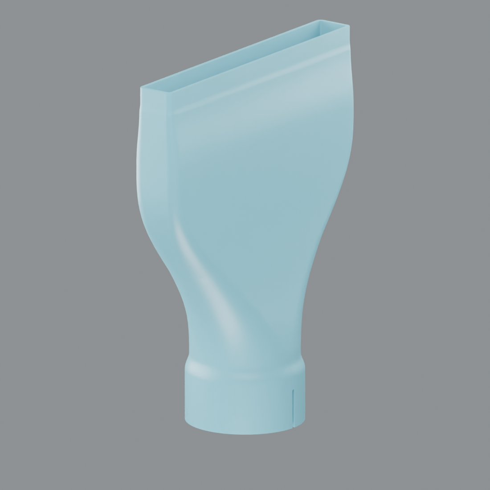
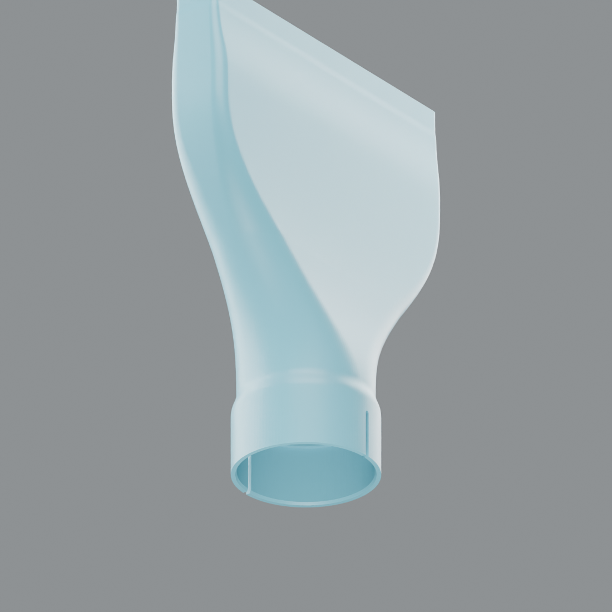
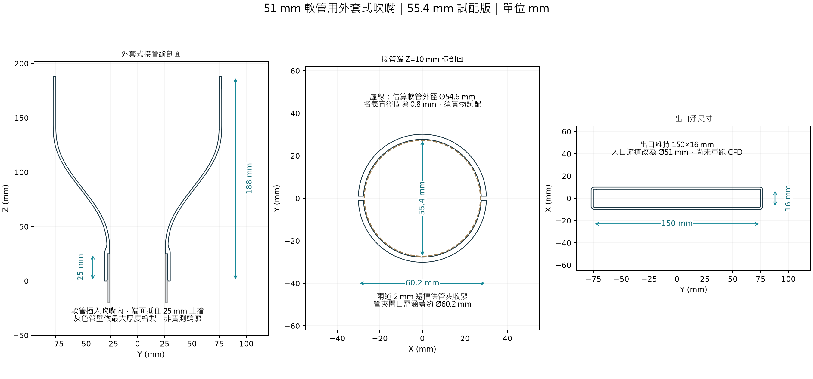

# 150×16 mm 吹嘴：外套式接管試配版

本次另存新版本，上一版三路接頭、吹嘴及 ZIP 未改動。先以 **55.4 mm 套口試配**，尚未確認實物尺寸、氣密、固定強度或實際列印結果；本版沒有重跑 ANSYS。

## 規格來源與尺寸推算

找到與使用者圖片完全相同的一列：[固得耐可繞性風管規格表](https://www.goodnice.com.tw/p-h05.html)。51 是內徑 mm，250 是重量 g/m，0.4／1.8 是最小／最大厚度 mm；廠商沒有直接列出外徑。

以最大厚度估算外包絡：51＋2×1.8＝**54.6 mm**。本版套口內徑 **55.4 mm**，預留 **0.8 mm 直徑間隙／0.4 mm 單側間隙**。這是設計估算，不是已量到的軟管外徑。

## 這次的接法

鼓風機 → 原三路接頭（外徑50 mm，插入管內）→ 內徑51 mm軟管 → 新吹嘴（軟管插入55.4 mm套口）→ 150×16 mm出口。

新吹嘴總高 **188 mm**，包絡約 **60.2×154.8×188 mm**；套入深度25 mm，內部有環形端面止擋。套口入口有1.2 mm長導入倒角，內徑在距端面1.2 mm以上回到55.4 mm；底端量到較大的倒角直徑屬設計幾何。

兩道2 mm寬、20 mm高的短槽讓管夾可收緊套口。使用開口能涵蓋約 **60.2 mm外徑** 的管夾，位置放在距吹嘴底端約5–14 mm範圍。短槽不是額外進風口；軟管必須插到底並固定，再確認接合處氣密與拉脫情況。止擋是周邊環形面，不含中央塞塊。

## 先試配，再印三顆

先印 `print/STL/fit_ring_ID55p4_mm.stl`。另附55.0與55.8 mm試配圈，供確認實物與列印公差；圈高10 mm，只用來確認套接尺寸，不代表完整固定或氣密已驗證。

正式吹嘴檔案：`print/STL/nozzle_150x16_female_ID55p4_H188_mm.stl`，整組需要3顆。若55.4 mm試配圈不合，應先依實物調整正式套口，再印完整吹嘴。所有STL採 **mm、100%比例** 匯入。

各零件有單件通用3MF，另有三顆吹嘴的K1C排版 `print/3MF/nozzles_quantity3_K1C.3mf`。幾何空間已核對含5 mm brim，三顆模型間距約11.8 mm；3MF沒有印表機或材料切片參數，尚未實際切片、實印。

## 風道與模擬狀態

本版吹嘴內部從51 mm流道開始，展寬段120 mm，接150×22 mm配風腔，再收至150×16 mm出口。它更改了上一版46 mm入口的幾何，舊版ANSYS壓損、風量及分布數值不能當成本版的驗證。本次只交付可試配的CAD原型，未宣稱風量增加、無回流或吹乾更快。

## 已核對

STL單一連通封閉實體、正體積、法向一致、沒有退化三角面；3MF以mm獨立重讀並核對K1C範圍。Blender由STL獨立量測套口55.4 mm、入口約51 mm、61個16 mm縫寬樣本、150 mm出口淨長，以及兩端188 mm等高；Blender原生檔重新開啟通過。

幾何網格完整不代表接管後已驗證氣密。實物套接、管夾固定、列印剛性與風場仍須確認。

