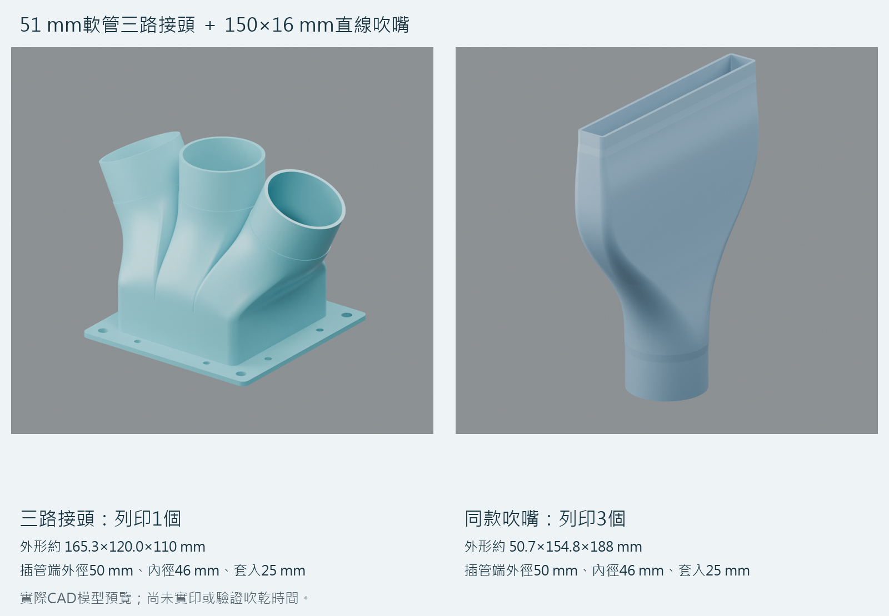
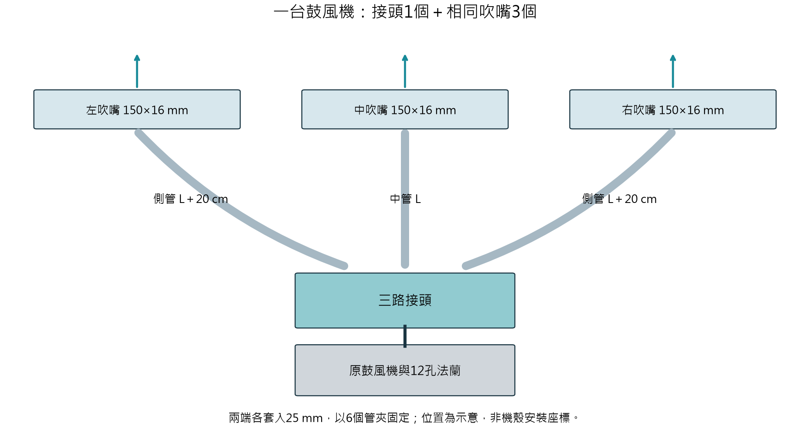
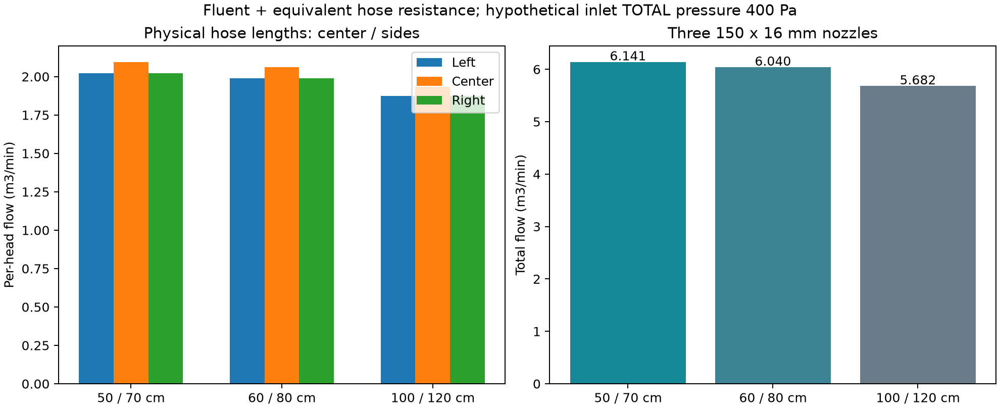
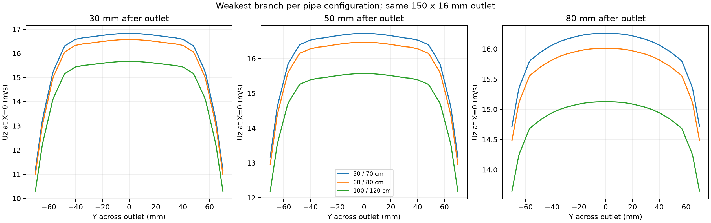
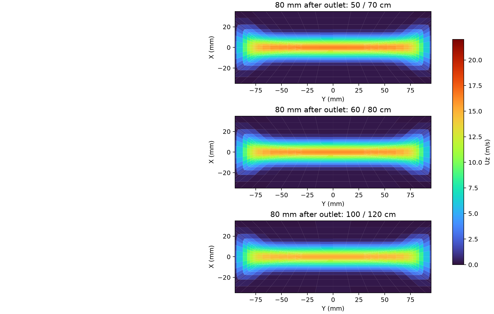
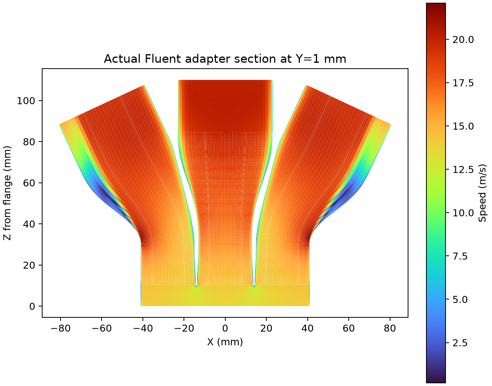
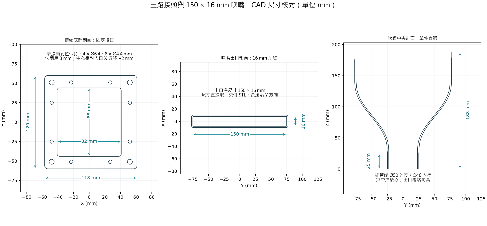

**交付狀態：可列印原型。** 使用者選擇先交付原型與報告，不加做瞬態模擬。三組主要管長比較、阻力敏感度、接頭細網格已通過工程收斂；吹嘴細網格仍有殘差振盪，僅保留為診斷，沒有算作通過驗證。其網格差異與均勻度數字不可視為已確認的精度。

# 51 mm軟管三路接頭與150×16 mm吹嘴

2026-11-14。單台鼓風機使用接頭1個、相同吹嘴3個、管夾6個。出口固定150×16 mm，氣流直通；原模型與原印件不改寫。

## 選定模型與管長結論

接頭選總高 **110 mm**、三個外徑 **50 mm**／內徑 **46 mm**套管端、插入長25 mm；保留82×88 mm入口與118×120×3 mm原12孔法蘭。三路共用口徑，未加入中央塞塊。吹嘴淨長150 mm、縫寬16 mm，內部展寬段120 mm；選型細節見`final_selection.json`及`nozzle_shape_screening.json`。

下表全部以**假設入口總表壓400 Pa**、空氣密度1.2 kg/m³、三個相同吹嘴計算，並非已量到的鼓風機實際風量。50／70代表中管裁切50 cm、左右各70 cm；已扣兩端各25 mm套入，等效51 mm通道長為45／65 cm。其他組同樣扣除，勿再重複加算接管段。

| 中管／側管裁切長cm | 左路m³/min | 中路m³/min | 右路m³/min | 合計m³/min | 相對三路平均最大偏差 | 出口面積換算平均風速m/s |
|---|---:|---:|---:|---:|---:|---:|
| 50／70 | 2.023 | 2.096 | 2.023 | 6.141 | 2.39% | 14.05–14.56 |
| 60／80 | 1.990 | 2.060 | 1.990 | 6.040 | 2.32% | 13.82–14.31 |
| 100／120 | 1.874 | 1.933 | 1.874 | 5.682 | 2.05% | 13.02–13.42 |

在此模型中，50／70 cm與60／80 cm相對100／120 cm總流量分別增加 **8.09%、6.32%**；前兩者相差 **1.66%**。管長比較固定其他阻力假設；若短管必須急彎或壓扁，實際排序可能不同。小幅差異不能視為實測保證。

## 吹嘴與出口分布

末端前8 mm保持直線縫，沒有中央核心、外部長補強肋或90°流道。出風分布以X=0、Y=±70 mm的140 mm中心線衡量；同面積動壓指標為固定140×20 mm範圍平均`0.5ρ max(Uz,0)²`；動量通量為固定140×80 mm範圍積分`ρ max(Uz,0)² dA`。它們是自由射流比較指標，不是傘面實際受力、剪力或乾燥時間。

本次選定吹嘴尚未完全達到中心線變異係數10%的設計目標；實際值如下。每組出口外流場以該組較弱支路的流量計算，不把中心較強支路當成全部三路。

| 管長組cm | 距出口cm | 140mm中心線平均Uz m/s | 中心線CV | 同面積動壓指標Pa | 同範圍動量通量N |
|---|---:|---:|---:|---:|---:|
| 50_70 | 3 | 15.93 | 8.86% | 98.27 | 0.5577 |
| 50_70 | 5 | 16.17 | 5.25% | 92.19 | 0.5277 |
| 50_70 | 8 | 15.97 | 2.27% | 81.59 | 0.4799 |
| 60_80 | 3 | 15.68 | 8.90% | 95.19 | 0.5403 |
| 60_80 | 5 | 15.92 | 5.28% | 89.32 | 0.5112 |
| 60_80 | 8 | 15.72 | 2.28% | 79.04 | 0.4649 |
| 100_120 | 3 | 14.80 | 9.12% | 84.63 | 0.4802 |
| 100_120 | 5 | 15.04 | 5.41% | 79.43 | 0.4545 |
| 100_120 | 8 | 14.85 | 2.35% | 70.30 | 0.4134 |

本次增加三個吹嘴與長軟管，覆蓋面積與原216×16 mm單嘴不同；不把總流量增加直接稱為局部吹力更強。

## ANSYS方法與限制

Fluent Student 2026 R1、3D雙精度、4 CPU、定常不可壓縮SST k–ω，ρ=1.2 kg/m³、μ=1.8×10⁻⁵ Pa·s。入口採均勻速度或均勻總壓、湍流強度5%，吹嘴入口水力直徑46 mm、接頭入口84 mm；外部環境為0 Pa壓力開放邊界。模型包含三路接頭與吹嘴；波紋軟管以等效阻力表示，未逐一建立波紋幾何。基準Darcy摩擦因子0.04、每路彎曲損失係數0.5，接合步差損失係數合計0.15；均為假設，非此軟管的量測數據，敏感度範圍也不是實品的保證上下限。

先由兩個處方流量的吹嘴CFD取得流量—所需總壓曲線，再與軟管阻力一起作為三個出口的等效負載；另在最終三個工作流量檢查開放外流場所需總壓，不以兩點擬合殘差作為精度證明。計算包含出口動能修正，並以接頭出口質量加權總壓核對一維阻力目標，誤差須小於2%。本次使用的[Fluent porous-jump模型](https://ansyshelp.ansys.com/public/Views/Secured/corp/v252/en/flu_ug/flu_ug_bcs_sec_bound_cond.html)只代表未展開的管路／吹嘴阻力，並非列印件內的實體濾網。

200／400 Pa壓力、摩擦因子與彎曲程度比較見`CFD_summary.csv`。風機未提供完整P–Q曲線；11 m³/min與460 Pa靜壓不能直接指定為本整套的共同工作點。模型不含葉輪、蝸殼、實際入口旋流、列印粗糙度、漏氣、傘布遮擋、液膜、液滴或蒸發，因此不能判定實機風機失速、吸入口回流或10秒吹乾已被解決。

接頭逆流統計只含實體接頭內、沿局部流向速度低於−0.01 m/s的單元體積；外部噴流邊界吸入環境空氣不視為鼓風機回流。

標準與較細O形網格的接頭總流量差為 **-0.06%**，最大支路佔比差 **0.053個百分點**。這是聯合網格密度／拓樸檢查，未做三層GCI。吹嘴另做截面加密與計算區域延伸，結果在`mesh_sensitivity_checks.json`；不能把這些差值當作物理誤差信賴區間。各網格cells與nodes均小於Student的一百萬限制，原生Fluent檢查確認正體積。

工程收斂門檻：連續性殘差<10⁻⁴，速度<10⁻⁶，k與ω<10⁻⁵；最後兩批流量及入口壓力變化<0.5%，質量不平衡<0.1%。另列是否全部殘差<10⁻⁵。

| 案例 | 最後迭代 | 連續性殘差 | 質量不平衡% | 工程收斂 | 全殘差<10⁻⁵ |
|---|---:|---:|---:|---|---|
| curve_selected_P22_q1 | 560 | 5.21e-05 | 1.66e-06 | 通過 | 否 |
| curve_selected_P22_q2.5 | 240 | 2.46e-05 | 3.09e-06 | 通過 | 否 |
| final_adapter_100_120 | 353 | 9.93e-06 | 1.63e-05 | 通過 | 是 |
| final_adapter_60_80 | 394 | 9.9e-06 | 1.01e-05 | 通過 | 是 |
| final_adapter_50_70 | 920 | 1.15e-05 | 1.6e-06 | 通過 | 否 |
| final_pressure200 | 172 | 9.97e-06 | 5.5e-06 | 通過 | 是 |
| final_friction_low | 1562 | 5.06e-06 | 4.3e-06 | 通過 | 是 |
| final_friction_high | 160 | 8.76e-06 | 1.82e-06 | 通過 | 是 |
| final_short_pipe_more_bends | 400 | 1.39e-05 | 2.13e-05 | 通過 | 否 |
| final_one_side_extra_bend | 330 | 9.7e-06 | 1.15e-05 | 通過 | 是 |
| reference_final_old_layout | 1480 | 9.51e-06 | 1.86e-05 | 通過 | 是 |
| final_jet_100_120 | 240 | 3.98e-05 | 7.51e-06 | 通過 | 否 |
| final_jet_60_80 | 200 | 2.81e-05 | 7.76e-06 | 通過 | 否 |
| final_jet_50_70 | 200 | 3.14e-05 | 9.1e-06 | 通過 | 否 |
| final_adapter_fine | 155 | 9.75e-06 | 1.12e-05 | 通過 | 是 |
| final_jet_fine | 600 | 0.00157 | 3.1e-05 | 未通過，僅診斷 | 否 |

原生case/data已重新開啟核對壓力及流量，見`native_reopen_checks.json`。完整原始CFD保留於計算目錄`C:\Users\otiso\umbrella\case\ThreeWay150_51mm_System_20261114`的`cfd`，ZIP收錄輕量結果與驗證紀錄。此Windows Fluent環境的重算須使用英文路徑；中文交付資料夾可用於列印及Blender，勿直接在中文路徑啟動CFD腳本。

## 列印與組裝

單位mm、100%匯入。列印`print/STL/splitter_H110_neck46_mm.stl` **1個**與`print/STL/nozzle_150x16_H188_W150_P22_mm.stl` **3個**。可先印`fit_sample_OD50_ID46_mm.stl`試套實際51 mm軟管。管嘴沒有超過50 mm的止滑凸圈；每端套入25 mm並用管夾固定，共6處。鼓風機端沿用原固定孔及密封方式。

3MF為標準模型與擺盤，沒有經驗證的切片參數或G-code。三嘴擺盤的模型間距、5 mm brim與K1C 220×220×250 mm空間已核對。實際切片、支撐、列印剛性與公差仍需確認；支撐只可從82×88 mm入口或46 mm圓口取出，不能封住流道。切片時核對2 mm管壁與出口壁形成連續實體線。

STL獨立重讀為封閉單件、無退化面；Blender重開、61點縫寬、150 mm淨長、81個流道截面、原12孔及三個插管端尺寸皆有紀錄。這些是幾何檢查，不是實印或氣密測試。吹嘴實際固定位置須配合機構安排，本次未修改機殼。

## 實測

維持相同電壓、風機檔位、管路與含水量，在3／5／8 cm各重複3次。記錄三嘴風速、吹10秒前後重量、停風後5秒滴數、入口方向、脈動及漏氣；模板為`physical_test_template.csv`。先比較相同距離與濕布，勿把管長、出風距離與出口尺寸同時改動後只歸因於接頭。

入口假設：接頭入口採均勻總壓，未重建鼓風機葉輪的旋流與偏流；各吹嘴入口採均勻軸向流，未傳遞軟管末端的偏流或旋流。因此三路均衡與長縫分布只適用於這些計算假設，實際彎管配置仍須量測。

吹嘴細算同時加密 O-grid 並將出口後外流場由 250 mm 延長至 400 mm，屬合併敏感度比較，沒有進行三組網格的 GCI 分析。

**數值敏感度目標未完全達成。** 吹嘴所需入口總壓按流量平方正規化後，相差 +7.86%；保留原先 5% 目標並列為未達標。下列風速與壓力為本輪模型的條件性預測，不能宣稱網格獨立、實際風機工作點已確認，或已證明比原本列印件吹乾更快。

SIMPLE 延續檢查依原型交付選擇在完成前停止，未作為最終 CFD 資料；原 Coupled 細網格保存結果僅供診斷。

[功能與驗證表](verification_matrix.csv) 彙整了已通過、未通過及尚未實測的項目。

部分殘差振盪的案例使用 Coupled 全域偽時間續算，將時間縮放係數降至 0.1，協助穩態迭代收斂；氣流模型、二階離散、負載邊界及收斂門檻保持一致。做法參考 [Fluent 偽時間法官方說明](https://ansyshelp.ansys.com/public/Views/Secured/corp/v252/en/flu_ug/flu_ug_sec_solve_pseudo.html)，各案例實際設定與負載前後對照見 continuation_boundary_integrity.json。

組裝時從每個圓管端面量 25 mm 畫記號，讓軟管按記號插入後以管夾固定；管長模型以這個插入深度計算。接頭採外徑 50 mm 光面插管端，沒有使用原版外徑 51.2 mm 的凸環。

內部迴流統計只計實體流道，排除外部捲吸及虛擬負載管段。接頭按局部流向、吹嘴按 Z 流向，統計速度低於 −0.01 m/s 的區域體積比。這是反向速度區的體積比例，不能當作倒灌流量或實際風機失速判定。吹嘴本體壓損由入口總壓減去出口後 0.01 mm 淨縫截面的向外質量流率加權總壓，沒有將遠端外流域混合損失列入。

| 案例 | 部件 | 內部反向區體積比 | 入口總壓 Pa | 本體總壓損 Pa |
|---|---|---:|---:|---:|
| final_adapter_100_120 | splitter | 0.0763% | 400.00 | 14.59 |
| final_adapter_60_80 | splitter | 0.0712% | 400.00 | 16.12 |
| final_adapter_50_70 | splitter | 0.0693% | 400.00 | 16.56 |
| final_adapter_fine | splitter | 0.1879% | 400.00 | 15.59 |
| final_jet_100_120 | nozzle | 9.2718% | 151.75 | 31.26 |
| final_jet_60_80 | nozzle | 9.2404% | 169.71 | 34.52 |
| final_jet_50_70 | nozzle | 9.2367% | 174.93 | 35.47 |
| final_jet_fine | nozzle | 11.2602% | 163.21 | 35.07 |

