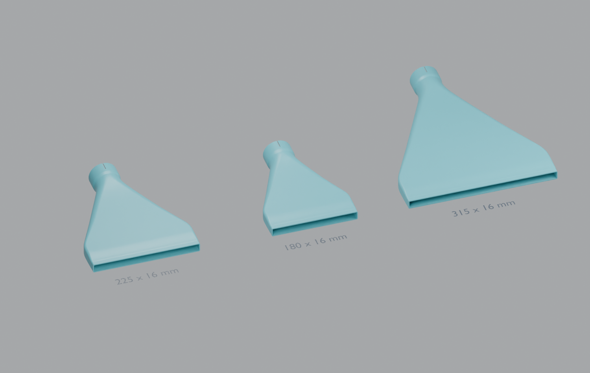
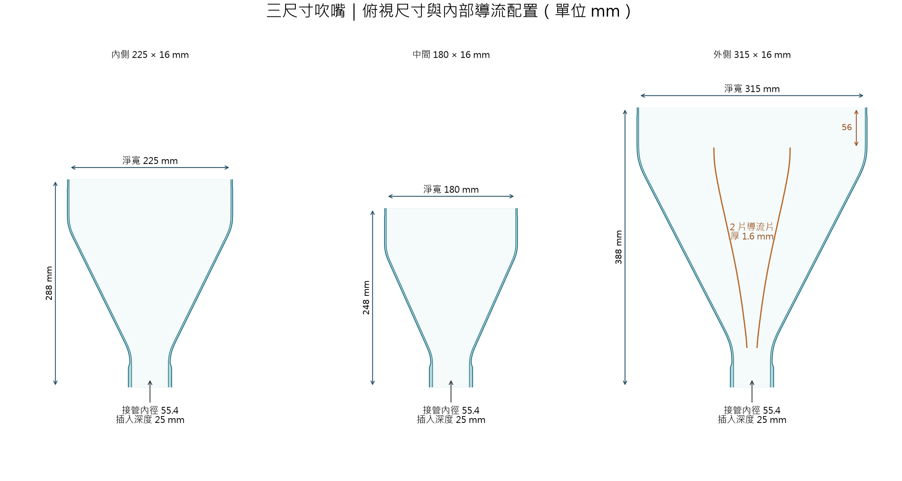
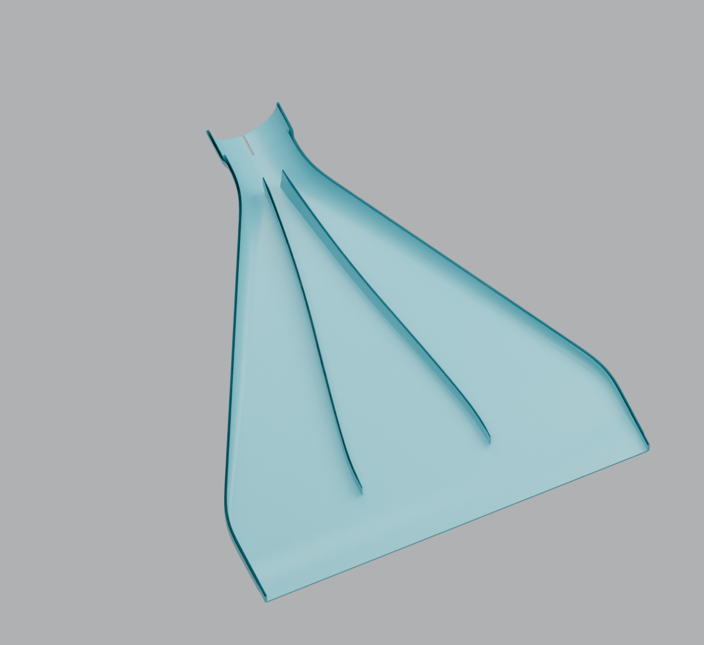
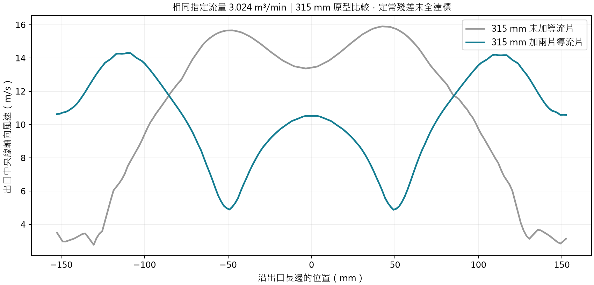
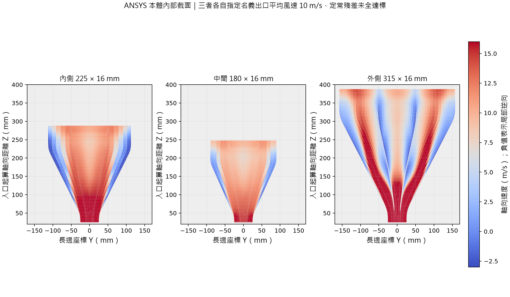
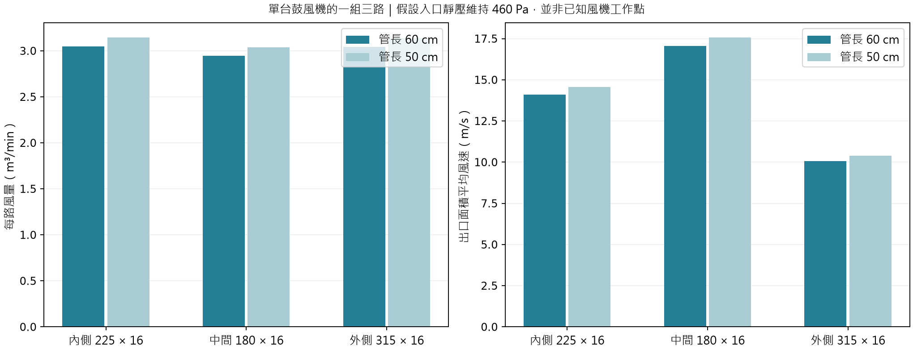

# 三尺寸完整吹嘴與風量重算

設計版本：2026-11-16；資料整理：2026-11-17 01:02。本次只另存三個吹嘴，內側 225／中間 180／外側 315 mm，出口間隙都為 16 mm。依最新要求，未以 K1C 容量限制幾何，交付完整件，尚未分件或驗證切片。原外殼與既有分流接頭未改造。

## 尺寸與接口

| 位置 | 淨出口 mm | 軸向總長 mm | 最大包絡 寬×厚×長 mm | 內部導流片 |
| --- | --- | --- | --- | --- |
| 內側 | 225 × 16 | 288 | 229.8 × 60.2 × 288 | 0 |
| 中間 | 180 × 16 | 248 | 184.8 × 60.2 × 248 | 0 |
| 外側 | 315 × 16 | 388 | 319.8 × 60.2 × 388 | 2 |

三者皆維持外套式接管：承口內徑 55.4 mm、插入深度 25 mm；管內徑 51 mm。55.4 mm 依先前估計的軟管外徑 54.6 mm 預留間隙，尚未實物套合確認。入口含束環收縮槽。名義殼厚 2.4 mm，出口唇部約 2 mm。完整 STL 單位為 mm。Blender 配置為水平出風，三件依內側／中間／外側排列；不是整機安裝配置圖。

315 mm 版有兩片與外殼相連的導流片，名義厚 1.6 mm、前後緣 0.8 mm，自入口座標 Z=55 到 332 mm，出口前仍有 56 mm 無分隔流道。中央軸線保持開通。圖中的剖開外殼只是觀察內部；交付 STL 是封閉完整外殼。

## ANSYS 直接計算的吹嘴比較

Fluent 2026 R1，三維雙精度、定常不可壓縮空氣，密度 1.2 kg/m³、黏度 1.8e-5 Pa·s、SST k–ω、入口擾動強度 5%、光滑無滑移壁。每個吹嘴模型包含內徑 51 mm、中心線半徑 90 mm 的進氣彎管。出口截面設為大氣壓，未包含外部射流與傘面。

下表各自指定流量，使淨出口名義平均風速約 10 m/s，供形狀比較；不是同一台風機會自行產生的三路流量。入口總壓為這個邊界下所需的總壓；總壓損為入口與出口質量加權總壓差，兩者意義不同。

| 位置 | 出口 mm | 指定 Q m³/min | 所需入口總壓 Pa | 彎管＋吹嘴總壓損 Pa | 中央線風速 CV | 局部負軸速體積占比 |
| --- | --- | --- | --- | --- | --- | --- |
| 內側 | 225 × 16 | 2.160 | 140.4 | 65.2 | 15.3% | 8.0% |
| 中間 | 180 × 16 | 1.728 | 107.2 | 39.2 | 5.6% | 2.4% |
| 外側 | 315 × 16 | 3.024 | 258.2 | 180.8 | 26.0% | 7.7% |

中央線 CV 取出口厚度中央，沿長邊兩端各略去 5 mm；完整截面面積加權 CV 另見 CSV。局部負軸速體積占比只統計吹嘴本體內軸向速度低於 -0.01 m/s 的流體體積，不能解讀成鼓風機回流風量或入口倒灌率。

315 mm 在相同指定 Q=3.024 m³/min 下，加導流片前後，中央線 CV 由 42.3% 降至 26.0%；局部負軸速體積占比由 17.2% 降至 7.7%。相應的總壓損由 142.2 增至 180.8 Pa，所需入口總壓由 250.4 增至 258.2 Pa。這是均勻度與損失的取捨，尚未消除全部逆向區域。導流片版採三通道網格，與無片版的網格數及拓撲也不同；兩者尚未完成網格獨立性檢查，這些差異目前只能作原型比較。

## 一組三路的風量重算

用各尺寸多組 Fluent 指定流量結果擬合 `入口總壓 = a Q² + b Q`，再以現有三路分流器的三維 Fluent 模型計算流量分配。下游負載含新吹嘴及 R90 上彎、51 mm 軟管、下彎與接頭。軟管長度指裁切總長，兩端插入共 50 mm，計算時扣除；Darcy 摩擦係數假設 0.04，下彎 K=0.5，接口 K=0.15（以 46 mm 截面速度計）。未實測的軟管粗糙度、皺褶、彎曲半徑及漏氣會改變結果。三維模型使用目前分流器中央插管較兩側長 10 mm 的接口形狀，未修改實體接頭。

| 淨寬 mm | 曲線樣本 Q m³/min | 樣本最大擬合誤差 | 末八批入口總壓範圍／均值最大值 |
| --- | --- | --- | --- |
| 180 | 1.200、1.728、2.400、4.000 | 0.48% | 0.14% |
| 225 | 1.300、2.160、4.000 | 0.59% | 1.19% |
| 315 | 1.500、3.024、4.500 | 1.18% | 1.04% |

擬合誤差是對這些數值樣本的吻合程度，不能當成實際風量誤差；末段迭代範圍也不是物理瞬態的統計不確定度。

| 條件 | 單組總 Q | 內側 Q | 中間 Q | 外側 Q | 入口靜壓 Pa | 入口總壓 Pa |
| --- | --- | --- | --- | --- | --- | --- |
| 假設入口靜壓 460 Pa、三管 60 cm | 9.037 | 3.048 | 2.947 | 3.042 | 460.3 | 723.9 |
| 假設入口靜壓 460 Pa、三管 50 cm | 9.321 | 3.146 | 3.037 | 3.138 | 458.6 | 739.0 |
| 強制指定總風量 11 m³/min、三管 60 cm | 10.998 | 3.672 | 3.658 | 3.668 | 675.1 | 1063.1 |

所有 Q 單位為 m³/min，以上均為單台風機的一組三路。若左右鏡像兩組、各用同樣的獨立風機，才可把整機總量相加。

同樣在假設入口靜壓 460 Pa 下，各路出口名義面積平均風速如下：

| 位置 | 淨寬 mm | 60 cm 管 m/s | 50 cm 管 m/s |
| --- | --- | --- | --- |
| 內側 | 225 | 14.11 | 14.56 |
| 中間 | 180 | 17.06 | 17.58 |
| 外側 | 315 | 10.06 | 10.38 |

入口靜壓維持 460 Pa 是假設條件。規格標示 11 m³/min 與 460 Pa，尚無完整 P–Q 曲線，也沒有實測工作點，不能據此保證風機能同時維持這兩個數字。強制 11 m³/min 那一列的用途是反算管路所需壓力，不能當作預測風機實際可供應 11 m³/min。管長 50／60 cm 表格亦採相同假設入口靜壓，方便比較管路影響。

分流器入口未帶入實測渦殼出口的偏流與旋流；葉輪、風機失速及整機入口倒灌也不在此模型內。

三個 16 mm 出口的總名義面積為 11520 mm²，比先前三個 150×16 mm 的 7200 mm² 增加 60%。在總風量固定且分布均勻時，合計面積平均風速為原來的 62.5%。因此加寬可增加覆蓋，不能直接承諾吹得更強；三條同徑管也不會自動按出口寬度比例分配流量。315 mm 那路需較大流量，才可達到與較窄吹嘴相同的平均風速。

## 驗證狀態與實際限制

| 案例 | 判定 | 質量不平衡 | 末段變化 |
| --- | --- | --- | --- |
| ramp_w225_L220 | 未通過 | 0.0003% | 0.009% |
| ramp_w180_L180 | 未通過 | 0.0003% | 0.021% |
| guide_w315_L320 | 未通過 | 0.0091% | 0.117% |
| network_Ps460_hose60 | 下游負載匹配通過；方程殘差未全通過 | 0.0002% | 流量變動 0.085% |
| network_Ps460_hose50 | 下游負載匹配通過；方程殘差未全通過 | 0.0002% | 流量變動 0.008% |
| network_Q11_hose60 | 下游負載匹配通過；方程殘差未全通過 | 0.0000% | 流量變動 0.011% |

吹嘴定常殘差仍有振盪，完整收斂條件未全通過。收斂判斷包含連續性 1e-4、速度 1e-6、紊流量 1e-5、壓力漂移與質量平衡；詳細殘差見檢查紀錄。三路案例的「下游負載匹配通過」僅表示壓力負載與流量迭代相符，不等於所有方程殘差皆收斂。未做網格獨立性、瞬態統計、外部射流、實際風機葉輪或傘面乾燥驗證。依先前選擇，這次交付可供試作的幾何與列明未達標項目的原型報告。

STL 獨立重讀通過單一連通實體、封閉網格、正體積、面方向、非退化三角面檢查；Blender 重新開檔後量測每個出口 61 個位置的縫寬、淨長、接管內徑及中央開通。原生 Fluent case/data 重新讀入，報表數字與正單元體積也已核對。這些檔案檢查不代表實際列印、套管配合或乾燥效果已通過。

實測時以相同轉速和管路，比較三路出口風速分布、入口倒灌、脈動、靜壓及乾燥時間；取得風機 P–Q 曲線或實測總風量後，才能把條件估算換成實際工作點。315 mm 版的兩端與中間仍有差異，應沿長邊量測，不能只量中央最高風速。

## 檔案

- `STL_完整件`：三個完整 mm STL，未切分。
- `CAD`：可重開的 Blender 完整模型。
- `圖片`：實際 STL 外觀、尺寸與剖視、CFD 比較圖。
- `三路風量_假設條件.csv`：各路流量與出口平均風速，含條件及負載匹配誤差。
- `ANSYS數值紀錄`、`檢查紀錄`：結果、歷程、網格及原生檔重讀紀錄。
- `來源程式`：本次幾何與計算程式，單位及邊界可重查。完整原始 CFD case/data 保留於本工作資料夾，另有主要案例 ZIP。
