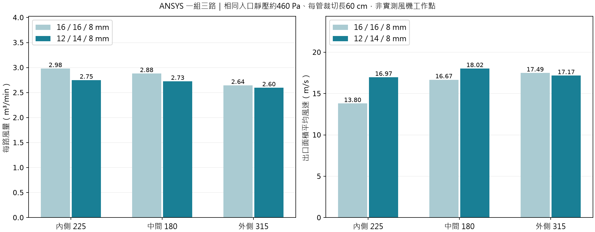
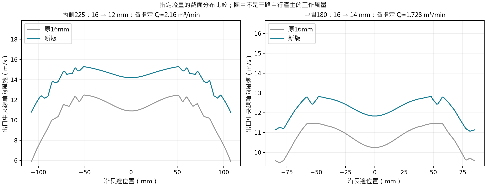
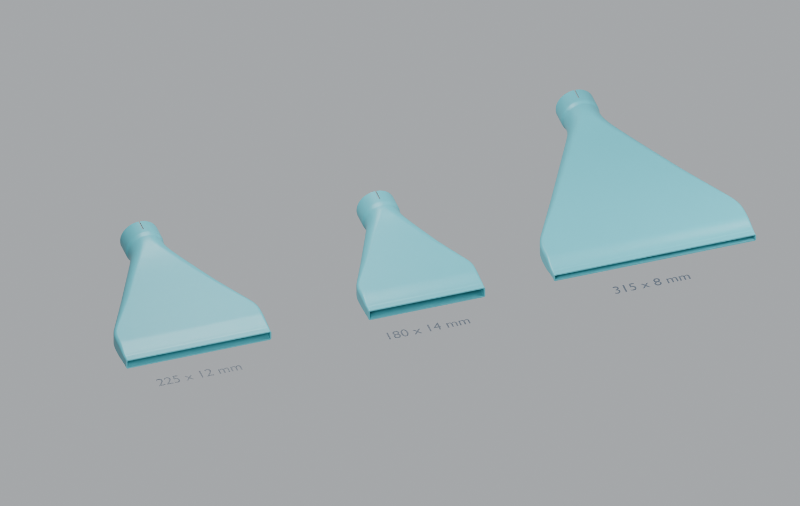
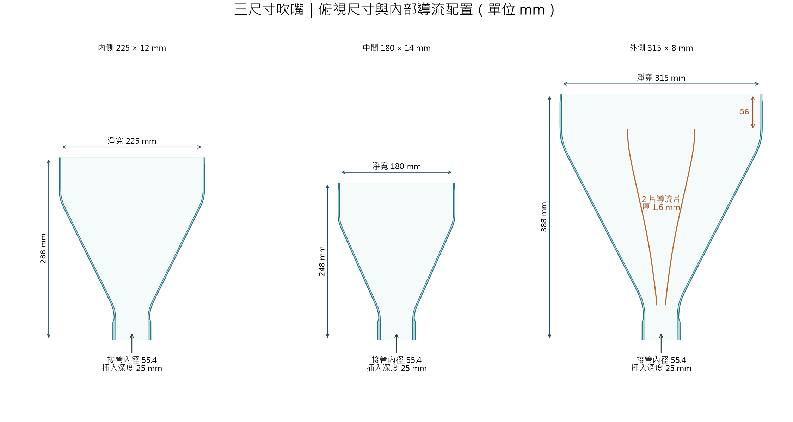
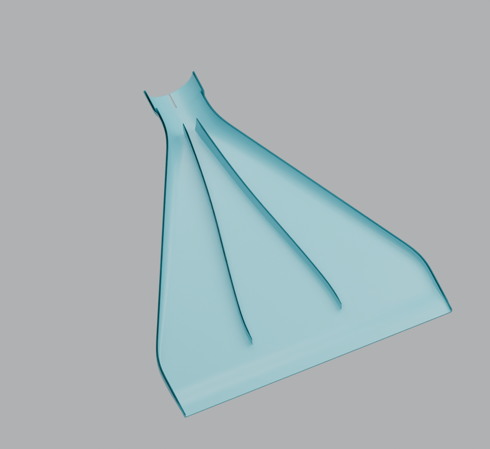

# 225×12／180×14／315×8 mm 吹嘴：同條件ANSYS重算

整理時間：2026-11-18 00:01 UTC+8。依使用者要求，重新以ANSYS比較內側225×12、中間180×14、外側315×8 mm。51mm管路、原有分流接頭與外殼維持；另存完整件，未受K1C容量限制，也未分件。

## 總風量少約5%，影響很多嗎？

前次「8.53降至8.11m³/min」是一維初估，約少4.9%、相當於每秒7公升。單看總風量比例不大，但不能換算成乾燥時間變慢4.9%。快乾仍取決於傘面位置的有效風速、覆蓋、脈動和實際水分移除，均尚未實測。

本次把現版16／16／8與候選12／14／8都放到相同入口靜壓及管長重新算。60cm裁切管的結果為 **8.505 → 8.070m³/min（-5.11%）**。內側平均出口風速變化 +23.0%，中間 +8.1%，外側 -1.8%。這是在假設壓力下，風量與風速的交換，不是乾燥效果已改善的證明。

| 位置 | 候選淨出口 mm | 現版風量 m³/min | 候選風量 m³/min | 現版平均風速 m/s | 候選平均風速 m/s |
| --- | --- | --- | --- | --- | --- |
| 內側 | 225 × 12 | 2.980 | 2.749 | 13.80 | 16.97 |
| 中間 | 180 × 14 | 2.880 | 2.725 | 16.67 | 18.02 |
| 外側 | 315 × 8 | 2.645 | 2.596 | 17.49 | 17.17 |

候選三個出口的名義面積為內側2700、中間2520、外側2520mm²，比現版3600、2880、2520mm²更接近。三路供風相近時，平均風速也較接近；上表仍採各路實際計算風量除以出口面積，沒有假設三路風量相等。

全部數值均為單台鼓風機的一組三路。330W、11m³/min、460Pa的標示尚不是完整風壓—風量曲線，本次未用11m³/min當強制工作風量；入口靜壓460Pa是比較情境，實際風機工作點未知。

## 比較條件與管長

參考版和候選版使用相同原分流器三維流體網格。入口靜壓目標460Pa，容許誤差0.1%；下游壓力負載匹配誤差0.5%，流量變動0.15%、質量不平衡0.05%，連續三批通過才保存完整匹配檢查點。這些是負載耦合門檻，與方程殘差門檻分開。

| 三管裁切長 cm | 現版總Q | 候選總Q | 總Q變化 | 現版實得入口靜壓 Pa | 候選實得入口靜壓 Pa |
| --- | --- | --- | --- | --- | --- |
| 60 | 8.505 | 8.070 | -5.11% | 460.25 | 460.19 |
| 50 | 8.763 | 8.287 | -5.44% | 460.25 | 460.19 |

Q單位m³/min。軟管內徑51mm，兩端插入共50mm從裁切長扣除。Darcy摩擦係數假設0.04，下彎K=0.5，接口K=0.15（以ID46截面速度計）。上方ID51、中心線半徑R90的90度彎管包含在各吹嘴CFD中。皺褶、漏氣與實際彎曲半徑尚未實測。

分流器入口82×88mm、三路ID46mm、實體插管長25／35／25mm，沿用中央較兩側長10mm的現有幾何。未模擬風機葉輪、渦殼原有偏流、風機失速或整機入口倒灌。

## 吹嘴直接CFD

Fluent2026R1，3D雙精度、定常不可壓縮空氣，密度1.2kg/m³、黏度1.8e-5Pa·s、SST k–ω、入口擾動5%，光滑無滑移壁。吹嘴出口截面設大氣壓，未包含外部射流或傘面。舊場只用於初始猜測，跨流量初始猜測按流量比縮放後，仍經實際Fluent迭代求解；交付結果沒有以縮放場替代計算。

內側與中間各算兩個指定流量點，擬合非負 `P_total=aQ²+bQ` 阻力曲線後耦合三路。所有候選各路的管路風量均落在各自曲線取樣範圍內。外側315×8mm幾何和曲線沿用前次已核對的結果。

| 新出口 mm | 指定Q m³/min | 所需入口總壓 Pa | 上彎＋嘴總壓損 Pa | 中央線CV | 局部負軸速體積占比 | 完整收斂 |
| --- | --- | --- | --- | --- | --- | --- |
| 180 × 14 | 1.728 | 126.1 | 40.2 | 4.1% | 2.4% | 未全通過 |
| 180 × 14 | 3.200 | 407.5 | 117.4 | 3.2% | 2.4% | 未全通過 |
| 225 × 12 | 2.160 | 186.0 | 67.2 | 8.1% | 6.6% | 未全通過 |
| 225 × 12 | 3.200 | 390.7 | 136.6 | 6.4% | 5.0% | 未全通過 |

入口總壓和總壓損意義不同。CV沿出口厚度中央計算，長邊兩端各略去5mm；完整截面CV另見CSV。局部負軸速體積占比只統計本體內軸向速度低於-0.01m/s的流體體積，不能當作鼓風機回流量。指定流量的形狀比較圖也不能當作三路管線自動產生的工作風量。

每條新曲線只有兩個CFD取樣點，擬合誤差小不代表實際精度；分離、回流與瞬態脈動仍可能造成誤差。詳細曲線係數、末段壓力變化與殘差保存在檢查紀錄。

## 模型與接口

| 位置 | 淨出口 mm | 軸向總長 mm | 包絡 寬×厚×長 mm | 導流片數 |
| --- | --- | --- | --- | --- |
| 內側 | 225 × 12 | 288 | 229.8 × 60.2 × 288 | 0 |
| 中間 | 180 × 14 | 248 | 184.8 × 60.2 × 248 | 0 |
| 外側 | 315 × 8 | 388 | 319.8 × 60.2 × 388 | 2 |

外側STL與前次315×8版雜湊一致。內側、中間只重建出口間隙，總長、入口及名義殼厚沿用：承口ID55.4mm、插入25mm、內流道51mm，殼厚約2.4mm、出口唇部約2mm。承口沿用原R90接頭OD55插口；若直接接軟管，原先估計外徑54.6mm，實物配合仍待確認。

外側保留兩片1.6mm導流片，自本體Z55至332mm，出口前56mm連通；內側、中間沒有新增中央核心或導流片。Blender出風軸水平、寬面平行地面，三個STL為完整件，尚未切分或驗證切片、整機碰撞與固定支撐。

## 驗證狀態

| 三路案例 | 最大下游負載誤差 | 質量不平衡 | 完整方程收斂 |
| --- | --- | --- | --- |
| reference_16_16_8_hose60 | 0.023% | 0.00004% | 未全通過 |
| reference_16_16_8_hose50 | 0.019% | 0.00003% | 未全通過 |
| candidate_12_14_8_hose60 | 0.021% | 0.00009% | 未全通過 |
| candidate_12_14_8_hose50 | 0.020% | 0.00003% | 未全通過 |

完整方程門檻為連續性1e-4、速度1e-6、k與ω各1e-5，並核對末段壓力變化與質量平衡。未全通過的案例必須保留為定常原型估算。負載匹配通過不能取代完整方程收斂。

本次新案例原生case/data已在獨立Fluent程序重新讀入，重新計算報表並檢查正單元體積。STL重讀核對封閉網格、單一連通實體、面方向、正體積與非退化面；Blender重開後量測61點縫寬、淨長、接管內徑及中央開通。尚未完成網格獨立性、瞬態統計、外部射流、真實風機工作點、實物配合與乾燥時間驗證。依先前選擇交付原型及列明未達標項目的報告。

建議以相同轉速、管長、吹距及初始含水狀態，比較傘面風速分布、入口倒灌、脈動和乾燥時間，再決定是否把總量損失換取較高出口風速作為定案。

## 檔案

- `STL_完整件`與`CAD`：三個完整mm STL及Blender模型。
- `三路風量風速_同條件ANSYS比較.csv`、`新吹嘴指定流量_壓損分布與逆向區域.csv`：數值與條件。
- `ANSYS數值紀錄`、`檢查紀錄`：結果、歷程、曲線、殘差與原生檔重讀。
- `ANSYS原始案例_case_data.zip`：本次四個吹嘴點、四個三路案例，加上沿用的兩個外側8mm點。
- `來源程式`供核對算法；重跑需保留本工作資料夾、前版來源結構與既有Python/ANSYS環境。
