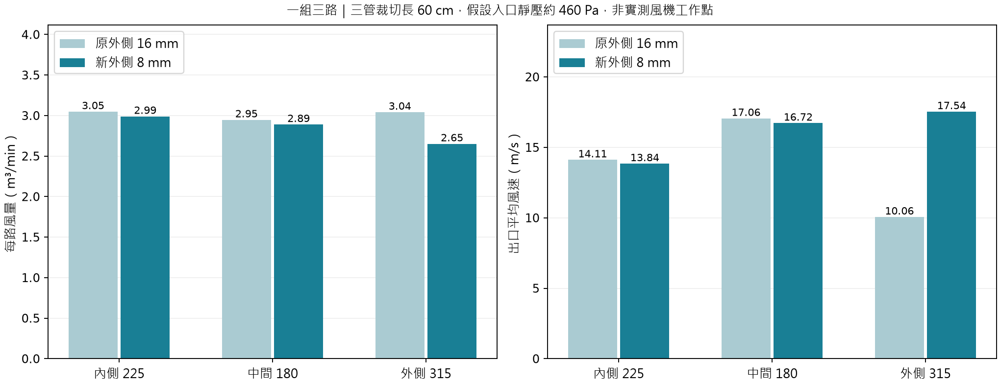
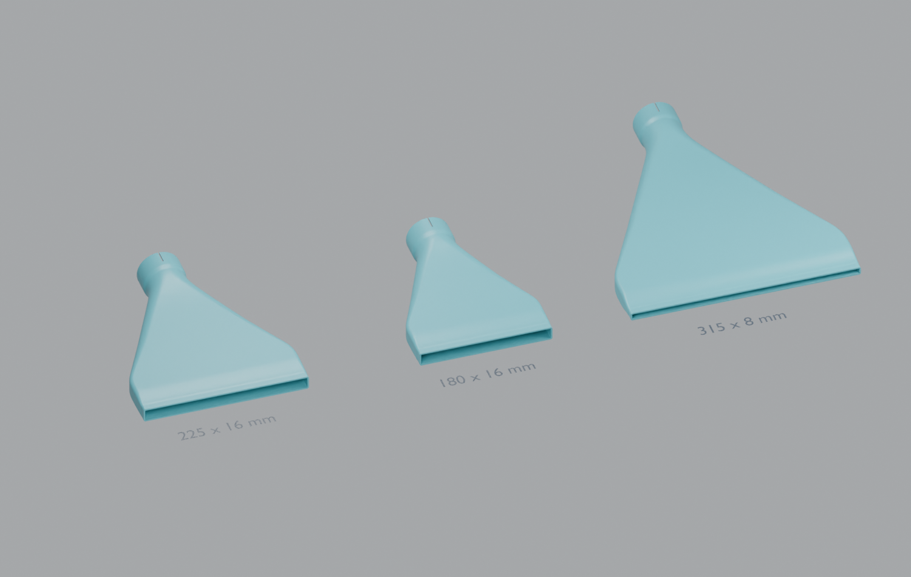
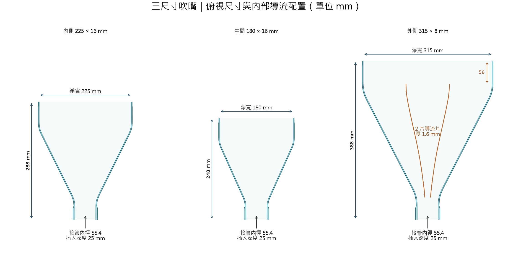
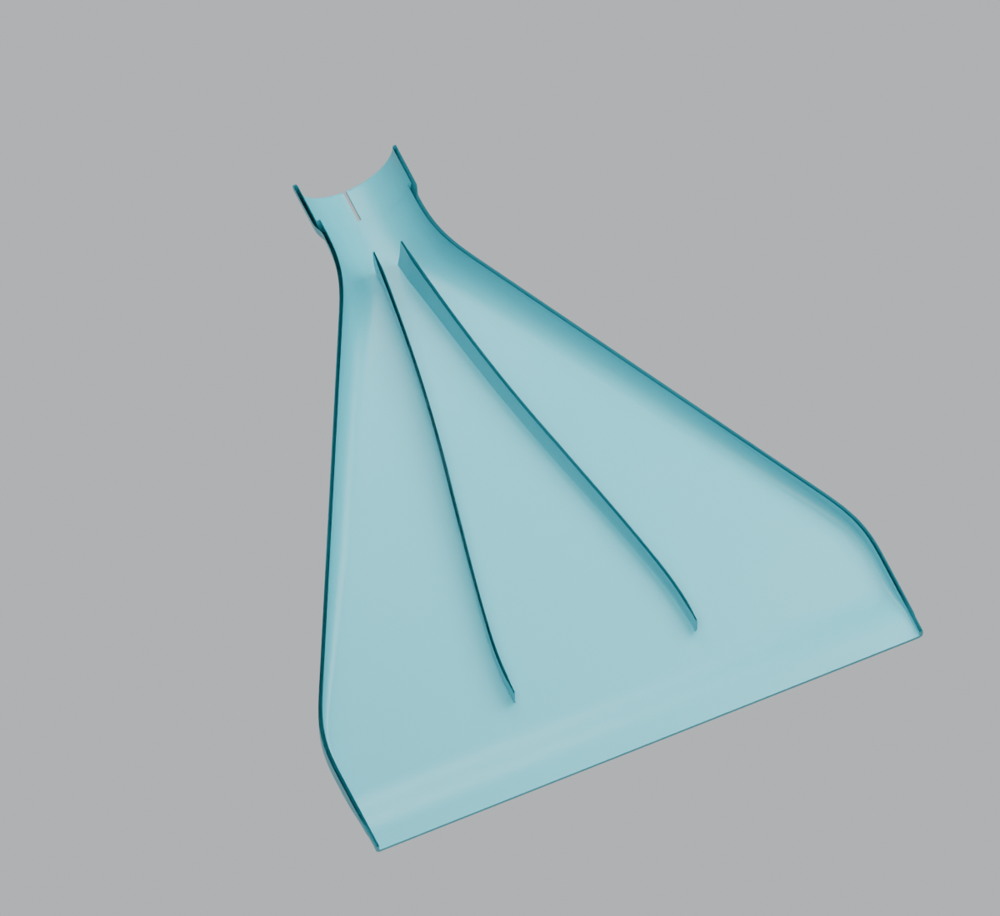
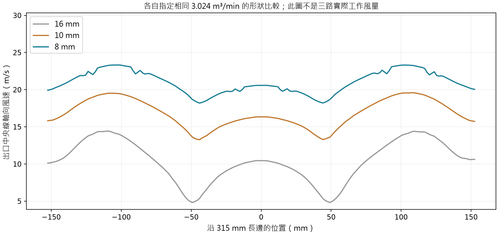

# 外側吹嘴收窄：維持 51 mm 管路

資料整理：2026-11-17 22:54 UTC+8。依最新選擇，只允許外側出口間隙縮小。內側225×16、中間180×16維持；外側比較315×16、315×10、315×8後選用 **315×8 mm**。這次另存完整件，未以 K1C 容量限制尺寸，也未切分；既有外殼、分流接頭和管徑都未改造。

## 主要結果

在三條裁切長60cm、入口靜壓假設約460Pa的同一情境下，外側出口面積平均風速由 **10.06 提高到 17.54 m/s（+74.3%）**。外側風量變化 -12.8%，單組總風量變化 -5.6%。縮口使風量改變，以下比較已把這項影響納入。

| 位置 | 新版淨出口 mm | 原風量 m³/min | 新風量 m³/min | 原平均風速 m/s | 新平均風速 m/s |
| --- | --- | --- | --- | --- | --- |
| 內側 | 225 × 16 | 3.048 | 2.990 | 14.11 | 13.84 |
| 中間 | 180 × 16 | 2.947 | 2.889 | 17.06 | 16.72 |
| 外側 | 315 × 8 | 3.042 | 2.652 | 10.06 | 17.54 |

以上均為單台鼓風機的一組三路，不是實測風機工作點。風機規格330W、11m³/min、460Pa尚缺完整P–Q曲線，無法據標示確定組裝後的實際風量。實際風機壓力隨總風量改變時，各路也會跟著改變。

## 完整件尺寸與接口

| 位置 | 淨出口 mm | 軸向總長 mm | 包絡 寬×厚×長 mm | 導流片數 |
| --- | --- | --- | --- | --- |
| 內側 | 225 × 16 | 288 | 229.8 × 60.2 × 288 | 0 |
| 中間 | 180 × 16 | 248 | 184.8 × 60.2 × 248 | 0 |
| 外側 | 315 × 8 | 388 | 319.8 × 60.2 × 388 | 2 |

三者承口內徑仍為55.4mm、插入25mm，內流道51mm，沿用原R90接頭外徑55mm的插口。若直接套軟管，55.4mm承口是依先前估計軟管外徑54.6mm留隙；這兩種實物套合皆尚未驗證。名義殼厚2.4mm、出口唇部約2mm。外側兩片1.6mm導流片保留，前後端0.8mm，入口座標Z55到332mm，出口前56mm仍連通，中央軸線無阻塞。

內側與中間STL雜湊與前版一致。Blender內出風方向水平，寬面與地面平行；此檔為獨立吹嘴配置，尚未核對新長度在整機內的安裝碰撞、固定支撐或管路走向。

## ANSYS 比較方式

Fluent2026R1、3D雙精度、定常不可壓縮空氣，密度1.2kg/m³、黏度1.8e-5Pa·s、SST k–ω，光滑無滑移壁，入口紊流強度5%。三個外側間隙使用相同網格拓撲與單元數，僅末端截面隨間隙縮放；這不是網格獨立性驗證。每個模型包含內徑51mm、中心線半徑90mm的上方進氣彎管，出口截面設大氣壓。未模擬外部射流與傘面。

先在指定Q=3.024m³/min下直接比較三種形狀；下表速度分布指標不能當作相同風機會自行產生的工作點。

| 外側間隙 mm | 指定Q m³/min | 所需入口總壓 Pa | 彎管＋嘴總壓損 Pa | 中央線CV | 局部負軸速體積占比 | 方程收斂 |
| --- | --- | --- | --- | --- | --- | --- |
| 16 | 3.024 | 259.7 | 182.1 | 26.4% | 7.8% | 未全通過 |
| 10 | 3.024 | 352.2 | 184.9 | 11.0% | 8.4% | 未全通過 |
| 8 | 3.024 | 445.5 | 189.1 | 7.0% | 8.5% | 未全通過 |

CV沿出口厚度中央量測，長邊兩端各略去5mm。局部負軸速體積占比只統計吹嘴本體內軸向速度低於-0.01m/s的流體體積，不是鼓風機回流量或入口倒灌率。入口總壓與總壓損是不同物理量。

初步候選排序使用單點阻力修正，最後選定版另算Q=2.000及3.024m³/min兩點，再擬合非負 `P_total=aQ²+bQ`，用於三路負載耦合。新版兩種管長的外側風量均落在這兩點範圍內。兩點擬合的誤差不能視為實物精度；原始壓力、末段振盪範圍及係數保留於檢查紀錄。內側、中間曲線沿用前版已重讀驗證的原生Fluent結果。

## 管長與分流計算

現有分流器的流體模型沿用82×88mm入口、三路ID46mm及中央插管比兩側長10mm的形狀。新吹嘴及R90上彎、軟管、下彎、接口負載一起計入，再迭代各路風量與壓力匹配。軟管ID51mm；裁切長扣除兩端插入共50mm；Darcy摩擦係數假設0.04，下彎K=0.5，接口K=0.15（以ID46速度計）。皺褶、實際彎曲與漏氣尚未量測。

| 三管裁切長 cm | 原單組總Q | 新單組總Q | 原外側 m/s | 新外側 m/s | 新版實得入口靜壓 Pa |
| --- | --- | --- | --- | --- | --- |
| 60 | 9.037 | 8.531 | 10.06 | 17.54 | 463.0 |
| 50 | 9.321 | 8.782 | 10.38 | 18.01 | 461.6 |

Q單位m³/min。50、60cm兩列都假設入口靜壓460Pa，方便比較管長。風機渦殼出口偏流、葉輪、失速及入口倒灌未建模。前版另做的強制總Q11m³/min試驗只反算所需壓力，不能當成風機實際流量；新版也不預設總Q為11。

## 驗證與限制

| 新版三路案例 | 最大下游負載誤差 | 質量不平衡 | 完整方程收斂 |
| --- | --- | --- | --- |
| network_narrow_Ps460_hose60 | 0.123% | 0.00004% | 未全通過 |
| network_narrow_Ps460_hose50 | 0.097% | 0.00003% | 未全通過 |

完整方程門檻包含連續性1e-4、各速度1e-6、k與ω各1e-5、質量平衡及末段壓力變化。任何未全通過的案例均保留為定常原型估算，不能視為完整驗證。負載匹配通過僅代表三路截斷模型與下游阻力一致，不代表所有方程收斂。

新案例原生case/data已在新Fluent程序重讀，重新計算報表並核對正單元體積。STL已獨立重讀確認封閉網格、單一連通實體、正體積、面方向及非退化面；Blender重開後核對每嘴61點縫寬、淨長、承口內徑與中央通道。未做網格獨立性、瞬態統計、真實風機工作點、外部射流、列印、套管、整機安裝與乾燥時間驗證。依先前選擇交付原型與列明未達標項目的報告。

縮窄後應以相同風機轉速、管路、距離實測沿315mm長邊的風速分布、入口倒灌、脈動及乾燥時間，不能只比較中央最高風速。取得P–Q曲線或實測靜壓/總流量後，才能更新為實際工作點。

## 檔案

- `STL_完整件`：三個完整mm STL，未切分；`CAD`為Blender完整模型。
- `新舊三路風量與風速_條件估算.csv`：前後版、兩種管長、各路風量與面積平均風速。
- `16_10_8mm_相同指定風量比較.csv`：三種外側截面的直接CFD比較。
- `ANSYS數值紀錄`與`檢查紀錄`：結果、歷程、曲線與原生檔重讀。
- `來源程式`供核對幾何與算法；重跑需保留本工作資料夾及前版來源的目錄結構，並使用既有Python/Fluent環境。
