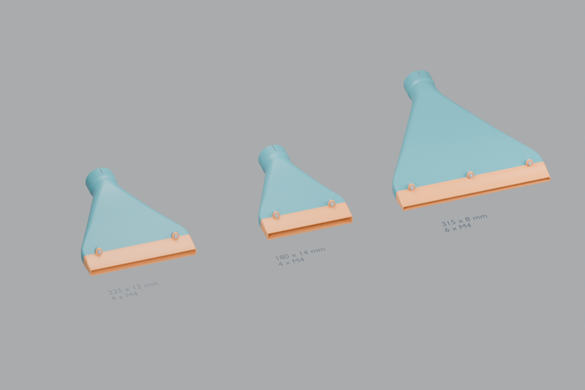
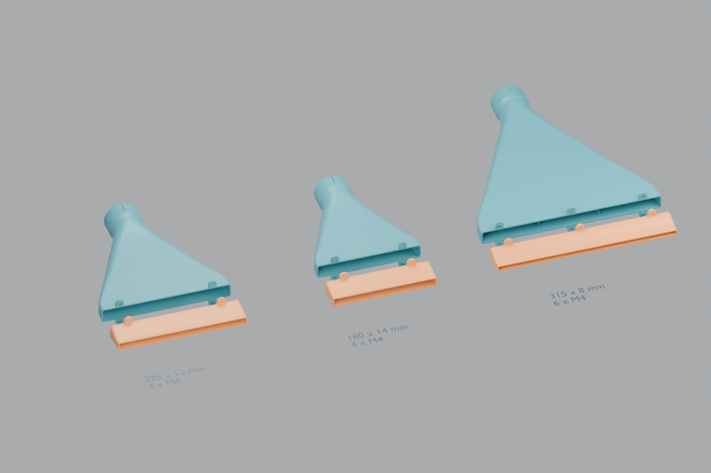
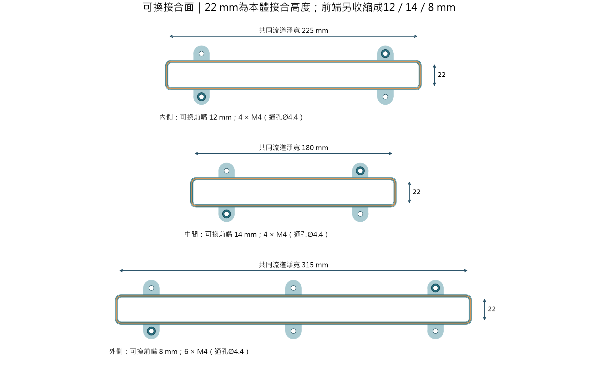

# 可換式三吹嘴：固定本體＋43mm前嘴

版本：2026-11-18；整理時間：2026-11-18 00:23 UTC+8。這次把三種吹嘴改為螺絲拆換結構，51mm管路、R90接頭與分流器接口沿用，另存新檔，未修改原模型。

## 先看風量代價

在相同假設入口靜壓約460Pa、三條裁切長60cm管的ANSYS比較下，現版16／16／8的總風量 **8.505 → 候選12／14／8的8.070m³/min（-5.11%）**。單看總風量損失不大，主要收益是補強原本較慢的內側。這不是實測風機工作點，也不能直接換算成乾燥時間。

| 位置 | 16／16／8平均出口風速 m/s | 12／14／8平均出口風速 m/s |
| --- | --- | --- |
| 內側 | 13.80 | 16.97 |
| 中間 | 16.67 | 18.02 |
| 外側 | 17.49 | 17.17 |

完整50／60cm比較、殘差與壓力假設見 [ANSYS報告](ANSYS比較/風量影響與ANSYS報告.md)。部分方程尚未達到設定收斂門檻，保留為原型估算。風機P–Q曲線、傘面風速、回流、脈動與乾燥時間仍待實測。

## 哪些零件要印

**主要裝配是6件：3個固定本體＋3個前嘴。另有2個16mm對照前嘴，可依需要列印。**

| 位置 | 零件用途 | STL檔名 | 包絡 寬×厚×高 mm |
| --- | --- | --- | --- |
| 內側225 | 固定導流本體 | 內側225_固定本體_mm.stl | 229.8 × 60.2 × 246.5 |
| 內側225 | 主要前嘴 | 內側225_前嘴12mm_mm.stl | 229.8 × 52.8 × 43.0 |
| 內側225 | 16mm對照前嘴 | 內側225_前嘴16mm_對照_mm.stl | 229.8 × 52.8 × 43.0 |
| 中間180 | 固定導流本體 | 中間180_固定本體_mm.stl | 184.8 × 60.2 × 206.5 |
| 中間180 | 主要前嘴 | 中間180_前嘴14mm_mm.stl | 184.8 × 52.8 × 43.0 |
| 中間180 | 16mm對照前嘴 | 中間180_前嘴16mm_對照_mm.stl | 184.8 × 52.8 × 43.0 |
| 外側315 | 固定導流本體 | 外側315_固定本體_mm.stl | 319.8 × 60.2 × 346.5 |
| 外側315 | 主要前嘴 | 外側315_前嘴8mm_mm.stl | 319.8 × 52.8 × 43.0 |

| 位置 | 主要出口 mm | 接合面距入口 mm | 可換前嘴長 mm | 組裝總長 mm | M4螺絲數 |
| --- | --- | --- | --- | --- | --- |
| 內側225 | 225 × 12 | 245 | 43 | 288 | 4 |
| 中間180 | 180 × 14 | 205 | 43 | 248 | 4 |
| 外側315 | 315 × 8 | 345 | 43 | 388 | 6 |

固定本體定位套會比接合面多凸出1.5mm，插入前嘴凹槽；前嘴STL的Z=0就是接合面，組裝時移到本體的接合座標。因此不能直接把兩件包絡高度相加當成組裝長度。

新固定本體需依本版印一次，之後改間隙只換最後43mm前嘴。內側12與16mm前嘴共用同一內側本體；中間14與16mm前嘴共用同一中間本體；外側此次提供8mm前嘴。不同寬度的本體與前嘴不混用。

藍色為固定本體，橘色為可換前嘴。Blender中的灰色五金僅為示意、不含螺紋，列印使用STL資料夾中的指定塑膠零件。Blender另有隱藏的16mm對照前嘴集合。

## 五金與定位

每組三路共需 **14支M4×16螺絲、14個M4螺帽、28個M4平墊片（外徑約9mm）**；內側4組、中間4組、外側6組。螺絲從前嘴端穿入，每端各一片墊片，以螺帽夾持。塑膠件沒有列印螺牙。

定位套與固定本體一體列印，不需另買定位銷。兩個對角螺絲位置兼作定位：一處為圓形定位凹槽，另一處沿長邊留浮動公差。其餘前嘴螺絲孔也沿長邊稍微放長，便於吸收列印長度誤差。

- 螺絲通孔名義Ø4.4mm；前嘴浮動長孔約4.4×5.4mm。
- 定位套外徑7.4mm、高1.5mm；對應凹槽Ø7.9mm、深1.8mm，單邊徑向間隙0.25mm、軸向間隙0.3mm。
- 本體與前嘴接耳各厚4mm，螺絲及接耳都在流道外側。
- 接合面共用流道高22mm，前嘴再逐漸收縮至12／14／8mm；22mm不是最前端的出風間隙。

## 組裝與更換

1. 核對位置與前嘴寬度，先乾裝，確認定位套能插入、兩側平面能貼合。
2. 本體接合面有寬1.2mm、深0.5mm的封閉密封槽，內側保留0.6mm接觸面。使用可拆的薄型壓縮密封材料，以夾緊後接合面能貼合為準；材料僅放在槽內，不能突出流道或把接面墊高。密封材料尺寸與實物壓縮效果尚待試裝。
3. 插入定位套，以M4螺絲、兩側墊片及螺帽對角分次均勻鎖附。列印接耳及反覆拆換耐用性尚未做實物強度測試。
4. 更換時拆下4或6組螺絲，沿出風軸取下43mm前嘴，清理並核對密封面，再換上另一個同寬前嘴。
5. 以相同風機轉速、管路、吹距和初始含水條件，比較16mm對照前嘴與12／14mm候選前嘴的傘面風速、接縫漏氣、入口倒灌、脈動及乾燥時間。

## 幾何與CFD對應

名義接合位置位於35mm收縮流道之前，前嘴包含35mm收縮段與8mm出口直段。理想平面貼合、密封良好時，主要內流道沿用本次ANSYS幾何；本次沒有把接縫漏氣、裝配錯位或密封材料擠入流道納入CFD。

8個STL已逐一獨立重讀，核對封閉網格、單一連通實體、正體積、面方向與非退化面；每組本體與各相容前嘴重讀後檢查名義裝配穿插，新增特徵未侵入接合區的流道探查體積。Blender重新開檔後核對各前嘴61點間隙、淨寬、22mm接合口、55.4mm承口、螺絲及定位尺寸，並核對組裝座標。

以上為模型檢查，未完成實物套合、氣密、機械強度、重複拆換、切片或列印驗證。K1C尺寸切件仍依先前要求暫不處理；目前是功能上的本體／前嘴拆分，不能據此保證每件都能直接放進K1C。

承口內徑55.4mm、插入25mm、主要流道ID51mm，沿用原R90接頭OD55插口。若直接套軟管，仍依先前估計外徑54.6mm留隙，實物配合待確認。

## 檔案位置

- `STL_主要零件`：6個必要塑膠件；`STL_比較用前嘴`：2個16mm對照前嘴。
- `CAD/可換式吹嘴_組裝_mm.blend`：原尺寸組裝模型，毫米制。
- `檢查紀錄`：零件雜湊、裝配穿插、流道探查與Blender尺寸重讀。
- `ANSYS比較`：本次連續流道的報告、CSV、圖片與收斂紀錄；圖中的一體外形是流體幾何參考。
- 完整原生case/data仍保留在本機 `C:\Users\otiso\umbrella\case\集風罩\三尺寸吹嘴_225x12_180x14_315x8_ANSYS_20261117\ANSYS原始案例_case_data.zip`。
- `來源程式`：機構與圖面程式；重跑需保留本工作資料夾與上層CFD來源及其環境。
